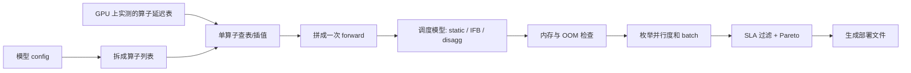
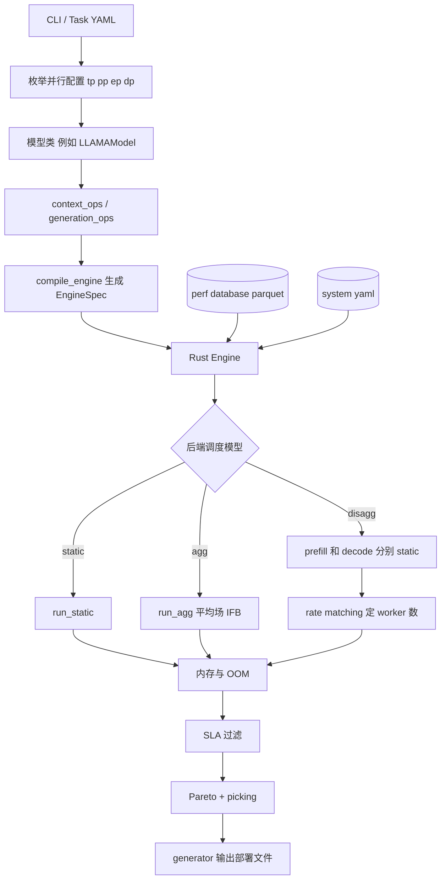
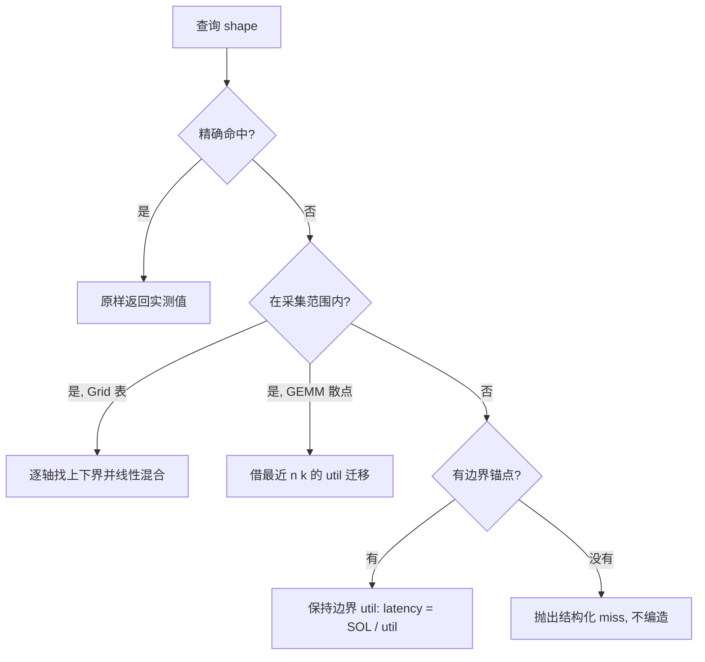
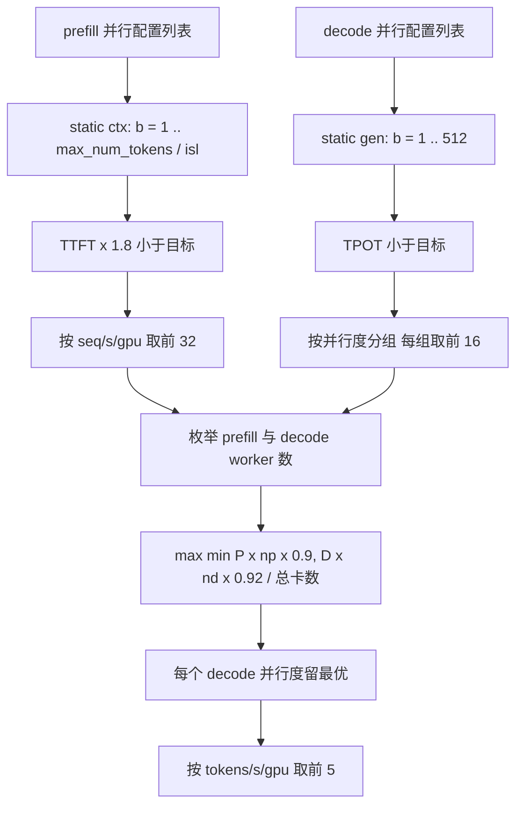

> 版本说明：本文基于 [ai-dynamo/aiconfigurator](https://github.com/ai-dynamo/aiconfigurator) 的 commit [`f254959eb89e2f206b8f9a77051644d7c1cbdb89`](https://github.com/ai-dynamo/aiconfigurator/tree/f254959eb89e2f206b8f9a77051644d7c1cbdb89)（2026-09-08）。文中的类名、函数名、常数和精度数字只对这个版本负责。仓库 README 已标明项目进入维护期，后续工作转向 AISimulate；本文仍按这个版本的代码解释它的设计。对应论文是 [arXiv 2601.06288](https://arxiv.org/abs/2601.06288)。

## 1. 先说结论

AIConfigurator（下文简称 AIC）解决的是一个部署问题：给定模型、GPU 型号、GPU 数量、推理框架和 SLA（TTFT、TPOT），在不真正起服务的情况下，找出 aggregated 或 disaggregated（prefill/decode 分离）部署里吞吐最高的配置，并直接生成 Dynamo 或 llm-d 的部署文件。

它的性能估算可以概括成一句话：**真实测过的单算子延迟 + 解析的调度模型 + 枚举搜索**。



读代码时可以先记住七个事实：

1. 最底层的数据是 collector 在真实 GPU 上逐个跑出来的算子延迟：GEMM、attention、MoE、AllReduce、NCCL 等，按 GPU、框架、框架版本分别存成 parquet。
2. 查不到精确点时，AIC 不直接对延迟做插值，而是在 **利用率空间** 里迁移：`util = SOL / measured`，`latency = SOL(query) / util`。SOL 是按 roofline 算出来的理论下界。
3. 一个模型被拆成固定的算子序列。prefill、decode、混合 batch 三种 forward 分别按不同的 shape 查询这些算子再求和。
4. aggregated 模式下的 in-flight batching 用一个稳态平均场模型描述：多少步是 prefill+decode 混合步，多少步是纯 decode 步，再加若干经验修正系数。
5. disaggregated 模式把 prefill worker 和 decode worker 分开估算，再枚举两边的 worker 数量做 rate matching。这一步目前不计 P→D 的 KV 传输开销。
6. 估算核心已经下沉到 Rust：Python 把模型编译成 `EngineSpec`，Rust `Engine` 是唯一的执行器，同一套核心也给 Dynamo 的 Mocker 和 planner 用。
7. 只有默认的 SILICON 模式对应可复现的实测数据；HYBRID、EMPIRICAL、SOL 是数据缺失时的补洞手段，精度依次下降。

## 2. 它要解决的问题

disaggregated serving 的配置空间很大。以一个 32 卡集群为例，需要同时决定：

- prefill worker 和 decode worker 各用几张卡、几个 worker；
- 每个 worker 的 TP、PP、EP、attention DP、CP；
- 每个 worker 的 batch size、`max_num_tokens`、chunked prefill 大小；
- 权重和 KV cache 的量化格式；
- 用 TensorRT-LLM、vLLM 还是 SGLang。

每个组合都真的拉起来压测，一个模型要花几天 GPU 时间。AIC 的思路是把“压测整个服务”换成“只压测一次算子，然后算”。算子数据和模型无关，可以复用；同一份 GEMM 表可以服务所有用到这组 shape 的模型。

README 里的例子是 Qwen3-32B-FP8 跑在 32 张 H200 上，ISL 4000、OSL 500、prefix 500，SLA 为 TTFT 300 ms、TPOT 10 ms。AIC 给出的 disagg 最优配置是 684.79 tokens/s/gpu，约为 agg 最优的 1.67 倍，整个搜索几秒钟。

## 3. 仓库结构

这个版本把代码拆成两个 Python wheel 加一个独立的采集工具：

| 目录 | 作用 |
|---|---|
| `aic-core/src/aiconfigurator_core/` | SDK 核心：模型定义、算子、后端调度模型、系统描述和性能数据 |
| `aic-core/rust/aiconfigurator-core/` | Rust 引擎（PyO3 暴露给 Python）：perf database、算子查询、forward 执行 |
| `src/aiconfigurator/` | CLI、task 配置、sweep、Pareto、picking、`inference_session`、generator |
| `collector/` | 在真实 GPU 上采集算子延迟，独立于 SDK 运行 |
| `src/aiconfigurator/generator/` | 把选中的配置渲染成 Dynamo / llm-d 部署文件 |

`src/aiconfigurator/sdk/` 下有一些文件只是兼容层，例如 `backends/base_backend.py` 只有 8 行，把模块重定向到 `aiconfigurator_core.sdk.backends.base_backend`。真正的实现要去 `aic-core` 里看。

CLI 有几种模式：

| 命令 | 作用 |
|---|---|
| `aiconfigurator cli default` | 给定 GPU 数和 SLA，同时搜 agg 和 disagg，输出对比和推荐 |
| `aiconfigurator cli estimate` | 给定一个具体配置，估算 TTFT/TPOT/吞吐 |
| `aiconfigurator cli exp` | 用 YAML 描述多组实验，批量跑 |
| `aiconfigurator cli generate` | 直接生成部署文件 |
| `aiconfigurator cli support` | 查某个模型/GPU/框架组合是否有数据 |

还有一个 `recommend` 路径在 default 的结果上做挑选；部署目标支持 `dynamo-j2`、`dynamo-python`、`llm-d-helm`、`llm-d-kustomize` 和 `fpm`。

## 4. 估算流水线总览



下面按这条链从下往上讲。

## 5. 系统描述与性能数据库

### 5.1 系统 YAML

每种 GPU 有一个系统描述，例如 [`systems/h200_sxm.yaml`](https://github.com/ai-dynamo/aiconfigurator/blob/f254959eb89e2f206b8f9a77051644d7c1cbdb89/aic-core/src/aiconfigurator_core/systems/h200_sxm.yaml)。它给 SOL 计算和通信建模提供参数：

| 字段 | H200 SXM 取值 | 用途 |
|---|---|---|
| `mem_bw` | 4.8e12 B/s | 访存 SOL |
| `mem_bw_empirical_scaling_factor` | 0.8 | 纯访存算子的有效带宽折扣 |
| `mem_empirical_constant_latency` | 3e-6 s | 纯访存算子的固定开销 |
| `mem_capacity` | 141 GiB | OOM 检查 |
| `float16_tc_flops` | 989 TFLOPS | bf16 计算 SOL |
| `fp8_tc_flops` / `int8_tc_flops` | 1978 TFLOPS | fp8/int8 计算 SOL |
| `num_gpus_per_node` | 8 | 节点内外通信划分 |
| `intra_node_bw` / `inter_node_bw` | 450 GB/s / 50 GB/s | 通信 SOL |
| `p2p_latency` | 10 us | PP 的 P2P 固定延迟 |
| `nccl_mem` | {1: 0, 2: 342 MB, 4: 392 MB, 8: 392 MB} | NCCL 显存开销 |
| `other_mem` | 3.5 GB | CUDA context 等杂项 |

这些都是名义值和经验值，并不是 profile 出来的峰值。SOL 只用来当参照系，真实性能靠实测数据里的 util 补回来。

### 5.2 数据布局

性能数据放在：

```text
systems/data/<system>/<op_family>/<backend>/<backend_version>/*.parquet
systems/data/<system>/.../collection_meta.yaml
```

也就是说，同一个算子在 H200 + vLLM 0.24 和 H200 + SGLang 0.5.10 下是两张表。框架升级后 kernel 可能变化，所以数据按版本隔离；manifest 可以声明从兄弟版本共享某些表。

算子族大致包括：GEMM（各种量化）、context/generation attention、MLA、DSA/CSA、MoE（含 WideEP、DeepEP）、custom AllReduce、NCCL 集合通信、Mamba/GDN、element-wise、embedding 等。

### 5.3 collector 怎么测

[`collector/`](https://github.com/ai-dynamo/aiconfigurator/tree/f254959eb89e2f206b8f9a77051644d7c1cbdb89/collector) 直接调用各框架的 kernel 或层实现，在目标 GPU 上逐 shape 计时：

- 采集前锁频、开 persistence mode，减少 boost 抖动；
- `benchmark_with_power` 用 CUDA graph 捕获被测 kernel，先 warmup 3 次，再跑 6 次起步、自适应最多到 3000 次，用 CUDA event 计时，同时记录功耗；
- GEMM 的 token 维度刻意取 `1..17, 32, 33, 48, 49, ...` 这种成对的边界值，因为 tile 边界两侧会出现 wave quantization 的锯齿，只采整数倍会把锯齿抹平；
- MoE 的 token 到 expert 分布默认用 power-law（见仓库里的 `docs/POWER_LAW_DISTRIBUTION.md`），用逆 CDF 采样生成负载不均衡的路由，而不是均匀分布。

这意味着数据库里每个点都是“单个 kernel 在 CUDA graph 下、孤立运行”的时间。后面所有估算都继承了这个前提。

## 6. 模型怎么拆成算子

每个模型族有一个模型类，负责给出 prefill（context）和 decode（generation）两组算子列表。以 [`models/llama.py`](https://github.com/ai-dynamo/aiconfigurator/blob/f254959eb89e2f206b8f9a77051644d7c1cbdb89/aic-core/src/aiconfigurator_core/sdk/models/llama.py) 为例，一层 dense decoder 被写成：

| 算子 | 类型 | shape（每卡） |
|---|---|---|
| `embedding` | Embedding | vocab × h |
| `add_norm_1` | ElementWise | 2h |
| `qkv_gemm` | GEMM | n = nh·d/tp + 2·d·nkv_per_gpu，k = h |
| `context_attention` / `generation_attention` | Attention | heads/tp, kv_heads/tp, head_dim |
| `proj_gemm` | GEMM | n = h，k = nh·d/tp |
| `ar_1` | CustomAllReduce | h |
| `add_norm_2` | ElementWise | 2h |
| `gate_ffn1_gemm` | GEMM | n = 2·inter/tp，k = h |
| `act_gate` | ElementWise | inter/tp |
| `ffn2_gemm` | GEMM | n = h，k = inter/tp |
| `ar_2` | CustomAllReduce | h |
| `logits_gemm` | GEMM（bf16） | n = vocab/tp，k = h |
| `p2p` | P2P | PP > 1 时 pp−1 次 |

每个算子带一个 `scale_factor`。层内算子的 `scale_factor = num_layers`，也就是只查一次单层延迟再乘层数。开启 MTP（multi-token prediction）时，decode 侧还要乘 `mtp_scale_factor = (nextn + L) / L`，表示每步多跑 `nextn` 个 draft 层。

MoE 模型把 FFN 换成 router GEMM + MoE 算子 + 可选的 shared expert；MLA、DSA、Mamba 等结构各有自己的算子类型。新模型的工作量主要在“写出正确的算子列表和 shape”。

## 7. 单个算子怎么估算

这是整个项目最核心的部分。

### 7.1 四种 database mode

| 模式 | 含义 | 什么时候用 |
|---|---|---|
| `SILICON`（默认） | 只用实测数据，加上同一张表内的插值和边界外推 | 默认，唯一可复现 |
| `HYBRID` | 先 SILICON，查不到再走经验模型补洞 | 新模型、新量化缺数据时 |
| `EMPIRICAL` | 全部走 util 空间的经验模型 | 验证经验模型本身 |
| `SOL` | 只用 roofline 理论值 | 看上界、做 sanity check |

### 7.2 SOL：每个算子的 roofline

所有算子都定义了 `SOL = max(sol_math, sol_mem)`，单位 ms。几个主要算子的公式如下（来自 Rust 的 [`perf_database/`](https://github.com/ai-dynamo/aiconfigurator/tree/f254959eb89e2f206b8f9a77051644d7c1cbdb89/aic-core/rust/aiconfigurator-core/src/perf_database) 和 [`operators/`](https://github.com/ai-dynamo/aiconfigurator/tree/f254959eb89e2f206b8f9a77051644d7c1cbdb89/aic-core/rust/aiconfigurator-core/src/operators)）。

**GEMM**（`m` 是 token 数，`n`、`k` 是权重维度，`b_q` 是该量化格式的每元素字节数）：

$$
\mathrm{sol_{math}} = \frac{2mnk}{\mathrm{FLOPS_q}},\qquad
\mathrm{sol_{mem}} = \frac{b_q\,(mn + mk + nk)}{\mathrm{mem\_bw}}
$$

**Context attention**（batch $b$、序列 $s$、query head 数 $n$、head dim $h$、KV head 数 $n_{kv}$）：

$$
\mathrm{ops} = \frac{2b \cdot s^2 \cdot n \cdot h \cdot 2}{2},\qquad
\mathrm{mem} = 2b(2nsh) + \mathrm{kv\_bytes}\cdot b \cdot 2 n_{kv} s h
$$

分母上的 2 对应 causal mask 只算一半。sliding window 把 $s^2$ 换成 $s \cdot w$。

**Generation attention**（每个请求只有 1 个新 token，KV 长度 $s-1$）：

$$
\mathrm{ops} = 2b \cdot n \cdot h \cdot 2 \cdot (s-1),\qquad
\mathrm{mem} = b\big(2nh + 2 n_{kv} (s-1) h \cdot \mathrm{kv\_bytes} + 2nh\big)
$$

decode attention 的计算量很小，几乎完全由读 KV 的带宽决定。

**纯访存算子**（element-wise、embedding 等，没有实测表）：

$$
t = \left(\frac{\mathrm{bytes}}{\mathrm{mem\_bw} \times 0.8} + 3\,\mu s\right)
$$

0.8 和 3 us 就是系统 YAML 里那两个经验字段。

**AllReduce** 的 SOL 按 ring 算：`2·size·2/tp·(tp−1)/p2p_bw`。P2P 直接用 `bytes / inter_node_bw + p2p_latency`。

**MoE** 的 token 数先乘 attention DP（多个 DP rank 的 token 汇到 EP 组里），计算量为 `tokens·topk·h·inter·num_gemms·2 / ep / tp`，访存除了激活还要加权重：只有被激活的 expert 权重会被读，读取量按 `min(ne/ep, tokens/ep)` 估。

### 7.3 SILICON 查询：一条四步解析链

实测表并不规整。attention 表的大 batch × 长序列角落因为 OOM 或耗时被跳过，GEMM 的 `(n, k)` 是一堆散落的真实模型 shape，不构成网格。旧版本在加载时把表“补成矩形”，带来大量合成点和防御代码；当前版本换成了统一的解析链（设计见 [`docs/design/perf_interp_design.md`](https://github.com/ai-dynamo/aiconfigurator/blob/f254959eb89e2f206b8f9a77051644d7c1cbdb89/docs/design/perf_interp_design.md)，实现已迁到 Rust 的 `perf_interp.rs`）：



几个要点：

- **实测点原样返回**。引擎不对数据做平滑，GEMM 的锯齿只要采到了就会保留。
- **插值的值空间按轴选**。context attention 沿序列轴近似 $s^2$，沿 batch 轴近似线性，所以只在 seq 轴上做 sqrt 变换。留一法测试里，seq 轴 sqrt 的误差是 3.21%，直接线性是 5.99%；全局 sqrt 的 interior 误差是 9.44%，按轴 sqrt 降到 2.00%。
- **跨 shape 迁移和外推都在 util 空间里做**。相邻 shape 的延迟在当前 shape 上没意义，但它的效率可以迁移，`SOL(query)` 再把 shape 带来的规模变化补回来。
- **GEMM 散点解析器**：查询的 `(n, k)` 如果没采过，就在 log 空间里找最多 4 个最近的已采 site（要求这些 site 的 m 曲线覆盖查询的 m，且距离在 2 个 octave 以内），用反距离加权混合 util。大词表 LM head 这种 n 超出所有已采值的情况，允许沿单个轴放宽距离门限。
- **超出采集范围**：取边界附近 `k_tail = 3` 个点的 util 中位数，保持不变，延迟按 SOL 缩放。
- **加载时 clamp**：如果某个实测点比 SOL 还快，加载时把它抬到 SOL，避免 util > 1 污染外推。

### 7.4 算子级修正

查表之后，部分算子还有专门的修正：

- **prefix cache 下的 context attention**：有 $p$ 个 prefix token 命中时，attention 按完整长度 $S = s + p$ 查表，再乘 $(S^2 - p^2) / S^2$，只计新 token 那部分的 causal 面积。非 attention 算子的 token 数是 `batch × (isl − prefix)`。
- **FP8 static GEMM**：从实测值里减去单独采集的 quantize/scale 开销，结果不低于 SOL。
- **AllReduce**：custom AllReduce 表有消息大小上限，超出时按带宽缩放；GB200 NVL72 上 TP > 4 改走 NCCL 表。
- **MoE**：SGLang 开 EPLB 时 prefill 乘 0.8，表示负载均衡后的收益。

### 7.5 HYBRID / EMPIRICAL：util 空间的经验模型

当 SILICON 完全查不到（新量化、新 head size、新框架版本），HYBRID 用经验模型补洞（设计见 [`hybrid_modeling_design.md`](https://github.com/ai-dynamo/aiconfigurator/blob/f254959eb89e2f206b8f9a77051644d7c1cbdb89/docs/design/hybrid_modeling_design.md)）。基本形式还是：

$$
\mathrm{latency} = \frac{\mathrm{SOL(query)}}{\mathrm{util}},\qquad \mathrm{util} = \frac{\mathrm{SOL}}{\mathrm{measured}}
$$

util 从标定数据里取：在归一化的 log 空间里找 2 个最近邻，按反距离（p=1）混合。如果目标 slice 本身没有数据，就按置信度从高到低走一条借用阶梯：

| 借用方式 | 从哪借 | 机制 |
|---|---|---|
| `xshape` | 同量化的最近 shape | 按 shape 特征最近邻，用自己的 SOL |
| `xquant` | 同 (访存, 计算) 档位的兄弟量化 | SOL 系数相同，util 直接迁移 |
| `xprofile` | 不同档位的量化 | 借来的 util 再乘每种量化的效率水平比 $e(q)/e(\mathrm{ref})$ |
| `xop` | 相关算子（如 MSA 借 DSA） | 手动对齐系数 |

GEMM 的效率水平是写死的经验值：bf16 0.70、int8 weight-only 0.55、fp8 0.45、int4 weight-only 0.45、nvfp4 0.30；MoE 的 bf16 是 0.53，w4a16 只有 0.07。

这套设计取代了旧的“`SOL / 固定常数`”做法，GEMM 留一法的平均误差从 64–341% 降到 7–15%，跨档位迁移从 58% 降到 24%。一个值得注意的细节是：util 可以大于 1，代码不会悄悄 clamp。文档里举了一个 util 14.58 的例子，最后查出是 collector 把 SGLang 的 full-attention 哨兵值 `-1` 写成了 `0`，测到的其实是一个接近 0 的窗口。这种值被当作坏数据信号，而不是被修剪掉。

### 7.6 精度数据

文档给出的留一法结果（H100 SGLang 0.5.10 / vLLM 0.19.0、GB200 SGLang 0.5.10）：

| 测试 | 中位误差 | p90 |
|---|---|---|
| GEMM interior | 4.87% | 15.6% |
| GEMM 边界外推 | 0.96% | 8.4% |
| GEMM 整个 (n,k) site 留出 | 3.63% | 14.7% |
| context attention interior | 2.00% | 9.7% |
| generation attention interior / 边界 | 1.1% / 9.7% | — |
| 任务级 Pareto 与旧引擎对比 | 0.3%（max 2.1%） | — |

HYBRID 文档里另有一组 EMPIRICAL 对 SILICON 的对比（B200 SGLang 0.5.10，不规则 off-grid 点），518 组可比点平均误差 1.88%、p90 4.99%、最大 10.18%。

这些数字衡量的是 **插值器相对实测算子表** 的误差，不是端到端服务性能的误差。文档也写明了尾部问题：在最小采集尺寸以下外推时，kernel 被 launch 开销主导，attention/MLA/DSA 的边界 p90 能到 45–52%。

## 8. 从算子到一次 forward

### 8.1 编译成 EngineSpec

Python 侧的 `compile_engine` 把模型的算子列表、shape、量化、系统参数打包成 `EngineSpec`（JSON 结构，再序列化为 bincode，schema 版本 15），交给 Rust 的 `Engine` 执行。Python 不再自己累加算子延迟，Rust 是唯一的执行器。这样做有两个好处：sweep 时不受 GIL 限制；Dynamo 的 Mocker 和 planner 可以直接调用同一个引擎拿 prefill/decode 延迟，和离线搜索结果保持一致。

### 8.2 三种 forward

Rust 的 [`engine/runtime.rs`](https://github.com/ai-dynamo/aiconfigurator/blob/f254959eb89e2f206b8f9a77051644d7c1cbdb89/aic-core/rust/aiconfigurator-core/src/engine/runtime.rs) 里定义了几种 step：

**context phase**：非 attention 算子的 token 数是 `batch × (isl − prefix)`，logits 只算 `batch` 个 token，attention 按 7.4 节的 prefix 规则查询。

**generation phase**：batch 内 token 数是 `batch × (nextn + 1)`，第 $i$ 步的序列长度是 `isl + i + 1`。OSL 很长时不逐步查询，而是每 32 步取一个点做数值积分，再除以 `osl − 1` 得到平均 TPOT。

**mixed step**（一次 forward 同时有 prefill chunk 和 decode token）分三路查询再相加：

1. 非 attention 算子当作一个 batch：`tokens = ctx_tokens + gen_requests × (nextn + 1)`；
2. context attention：`batch = ceil(ctx_tokens / isl)`，长度为 isl，再除以 `ceil(isl / ctx_tokens)`（一个请求被切成多个 chunk 时，每步只算一个 chunk 的份额）；
3. generation attention：`bs = gen_requests × (nextn + 1)`，序列长度固定取 `isl + osl // 2 + 1`。

**decode step**（只有 decode）同样把序列长度固定在 `isl + osl // 2 + 1`，用中点近似整个 decode 过程的平均 KV 长度。

这里的关键假设是：一次 forward 的延迟等于各算子孤立测量值的和。GEMM 和通信的重叠、kernel 之间的空隙、CPU 调度开销都没有进来，后面的后端模型会用常数补一部分。

## 9. 服务模式：static、agg、disagg

### 9.1 static

static 是“一批请求一起进、一起出”的模式，也是 disagg 里 prefill/decode worker 的估算单位（[`base_backend.py`](https://github.com/ai-dynamo/aiconfigurator/blob/f254959eb89e2f206b8f9a77051644d7c1cbdb89/aic-core/src/aiconfigurator_core/sdk/backends/base_backend.py) 的 `run_static`）：

$$
\mathrm{TTFT} = T_{enc} + T_{ctx},\qquad
\mathrm{TPOT} = \frac{T_{gen}}{\mathrm{osl}-1}
$$

$$
\mathrm{seq/s} = \frac{\mathrm{global\_bs}}{T_{request}} \times 1000 \times pp
$$

乘 $pp$ 是因为流水线里同时有 $pp$ 个 micro-batch 在跑。每卡吞吐再除以 `tp × pp × dp`。

### 9.2 aggregated：平均场 IFB 模型

agg 模式下 prefill 和 decode 共用一个引擎，靠 in-flight batching 和 chunked prefill 交织。AIC 不模拟到达过程，而是假设引擎稳态时一直维持 $b$ 个并发请求，每步最多处理 `ctx_tokens` 个 prefill token（`run_agg`）：

$$
\mathrm{decode\_iters} = 1 + \frac{\mathrm{osl}-1}{\mathrm{tokens\_per\_iter}},\qquad
N_{ctx} = \left\lceil \frac{\mathrm{isl}\cdot b}{\mathrm{ctx\_tokens}} \right\rceil
$$

$N_{ctx}$ 是把 $b$ 个请求的 prompt 全部吃完需要的步数。`tokens_per_iter` 在投机解码时等于平均接受长度，否则为 1。

- 如果 $N_{ctx} \ge \mathrm{decode\_iters}$：每一步都是混合步，共 $N_{ctx}$ 步；
- 否则：$N_{ctx}$ 个混合步，加上 $\mathrm{decode\_iters} - N_{ctx}$ 个纯 decode 步，纯 decode 步的 batch 为 $b$；
- $b = 1$ 单独处理：1 个混合步，其余全是 decode。

混合步里 decode 请求数默认是 `b − ceil(ctx_tokens / isl)`（正在 prefill 的请求不参与 decode）。然后：

$$
\mathrm{TTFT} = T_{enc} + \Big(T_{mix}\cdot\left\lceil \tfrac{\mathrm{isl}}{\mathrm{ctx\_tokens}} \right\rceil + T_{dispatch}\Big)\times q(b, N_{ctx})
$$

$$
\mathrm{TPOT} = \frac{T_{mix}\cdot N_{mix}' + T_{gen}\cdot N_{gen}}{(N_{mix}' + N_{gen})\cdot \mathrm{tokens\_per\_iter}}
$$

$$
\mathrm{throughput} = \frac{1000 \cdot b \cdot (\mathrm{osl}-1)}{T_{enc} + N_{mix} T_{mix} + N_{gen} T_{gen}} \times pp \times dp_{attn}
$$

$q$ 是排队系数：同一批请求同时到达，后面的请求要等前面的 prefill。默认公式是 $\min(2 + (N_{ctx}-3)/20,\ 4)$。$N_{mix}'$ 是专门给 TPOT 用的混合步数，可以和真实步数不同，用来吸收 prefill 与 decode 交界处的调度气泡。

**各后端的差异就体现在这些 hook 上**：

| hook | 默认 | vLLM | TRT-LLM | SGLang |
|---|---|---|---|---|
| 混合步 decode 请求数 | 按两种情况分别算 | 恒为 `b − ceil(ctx/isl)`（v1 scheduler 默认只有 1 个 partial prefill） | 默认 | 默认 |
| TPOT 用的混合步数 $N_{mix}'$ | $N_{mix}$ | 默认 | `max(1, N − 3)` | `N − 3` |
| 排队系数 $q$ | $\min(2 + (N_{ctx}-3)/20, 4)$ | $\min(1 + \log_2 b / 8,\ 2)$ | 默认 | 默认 |
| dispatch 开销 | 0 | 0.8 ms × 层数 | 0 | 0 |
| 吞吐上限 | 无 | Little's law：$b(\mathrm{osl}-1)\cdot 1000 / (\mathrm{TTFT} + \mathrm{TPOT}(\mathrm{osl}-1))$ | 无 | 无 |

vLLM 那组常数在代码注释里写明了来历：0.8 ms/层的 CPU dispatch 开销是在全量 silicon 语料上重新标定的；$\log_2 b / 8$ 的排队系数把 vLLM agg 的 TTFT MAPE 从 26.4% 降到 18.0%。这些常数说明了一件事：只靠算子求和，TTFT 会系统性地偏乐观，需要用端到端数据回拟。

搜索时（`find_best_agg_result_under_constraints`），batch size 从 `1..15`、`16–32 步长 4`、`32–64 步长 8`、`64–256 步长 16`、`256–512 步长 32`、512、1024 里取，`ctx_tokens` 也枚举一组；一旦某个 batch OOM 就停止向上搜，最后按 SLA 过滤。结果会按并行配置缓存，同一并行配置下只建一次 backend，复用 `_agg_cache`。

### 9.3 disaggregated：分别估算再 rate matching

disagg 在 [`inference_session.py`](https://github.com/ai-dynamo/aiconfigurator/blob/f254959eb89e2f206b8f9a77051644d7c1cbdb89/src/aiconfigurator/sdk/inference_session.py) 的 `DisaggInferenceSession` 里：



具体步骤：

1. **prefill worker**：对每个并行配置跑 static context，batch 从 1 到 `max_num_tokens // isl`。TTFT 先乘 1.8 再和目标比较。1.8 的来源写在注释里：设单个 prefill worker 的本地并发为 $lc$，$N$ 份并发请求的平均等待为 $(lc(lc+1)/2 + lc(N-1)) / lc / N$，取 $N=10$ 约为 $lc/20 + 0.95$，$lc$ 取 15–20 时约 1.7–1.95，于是取 1.8 作为“预修正”。通过的配置按 `seq/s/gpu` 降序、`global_bs` 升序取前 32 个。
2. **decode worker**：对每个并行配置跑 static generation，batch 从 `1..15`、`16–32 步长 2`、`32–128 步长 4`、`128–512 步长 8`、512 里取，保留 TPOT 小于目标的点，按并行度分组，每组取 `seq/s/gpu` 最高的 16 个。
3. **rate matching**：对每一对 (prefill 配置, decode 配置)，枚举 prefill worker 数 $n_p$ 和 decode worker 数 $n_d$，最大化

$$
\frac{\min\big(P \cdot n_p \cdot 0.9,\ D \cdot n_d \cdot 0.92\big)}{g_p n_p + g_d n_d}
$$

$P$、$D$ 是单个 worker 的 `seq/s`，$g_p$、$g_d$ 是单个 worker 的卡数。0.9 对应 prefill 的流水线气泡，0.92 对应 decode batch 填不满。如果指定了总卡数，只保留卡数在集合里的组合。SGLang 的非 WideEP disagg 还要求两边 TP 相同。
4. 每个 decode 并行度只保留最优组合，再取全局前 5。

`DisaggInferenceSession` 的 docstring 里留着一条 TODO：“should consider kvcache model in future”。也就是说，prefill 到 decode 的 KV 传输时间和带宽占用目前不在模型里。对长 ISL、跨节点 P/D、或者网络较弱的集群，这一项可能不小。

### 9.4 其他模式

代码里还有几条延伸路径，这里只列出存在：

- **投机解码 / MTP**：用户必须给出 `nextn_accepted`（平均接受长度），它决定 `tokens_per_iter`；decode 每步 token 数是 `batch × (nextn + 1)`；
- **CP（context parallel）**：KV 和 token 按 CP 切，部分 attention kernel 按 chunk 分解查表；
- **AFD（attention-FFN disaggregation）**、**EPD（encoder-prefill-decode）**：多模态模型把 encoder 单独成段；
- **FPM**：vLLM 专用，用 Dynamo 原生 self-benchmark 测出的整次 forward 表，而不是逐算子求和；
- **Predictor 协议**：`AnalyticPredictor` 是现在的实现，接口预留给动态模拟器或 Mocker。

## 10. 内存与 OOM

`_get_memory_usage` 把每卡显存拆成五项：

| 项 | 估算方式 |
|---|---|
| 权重 | 所有算子权重之和 / pp |
| 激活 | `2 × tokens × h × c[tp]`，系数 `c = {1: 10, 2: 6, 4: 5, 8: 5}`，加 MoE workspace，下限 70 MB，MTP 时按层数比例放大 |
| KV cache | `bs × kv_bytes_per_token × (isl + beam × osl) / cp` |
| NCCL | 系统 YAML 的 `nccl_mem[tp]` |
| 其他 | `other_mem`，H200 是 3.5 GB |

总和超过 `mem_capacity` 就判 OOM。然后再检查 KV cache 预算：各框架给 KV 的显存比例不同，有的按空闲显存比例算（`(cap − non_kv) × frac`），有的按总显存比例算（`cap × frac − non_kv`）：

| 后端 | 默认 KV 比例 |
|---|---|
| vLLM | 0.14/0.19 版本 `gpu_memory_utilization = 0.9`，0.22+ 为 0.92，按总显存，容差 0.02 |
| TRT-LLM | `free_gpu_memory_fraction = 0.9`，另留 0.015 |
| SGLang | `mem_fraction_static = 0.88`，激活额外 +15%，其他开销 +20% |

激活系数和那几个百分比是经验常数。README 的 known issues 里也承认内存估算还需要研究：实际框架里的 CUDA graph 显存、allocator 碎片、采样 buffer 都会让可用 KV 比模型算出来的少，最终表现为 AIC 推荐的大 batch 在真实服务里装不下。

## 11. 搜索、Pareto 和挑选

### 11.1 枚举空间

`task_v2.py` 根据 GPU 数和模型类型生成并行度列表：dense 模型主要枚举 TP、PP；MoE 模型同时枚举 EP 和 attention DP；NVL72 这类机柜级系统允许 EP 在 4 到 32 之间。agg 走 `sweep_agg`，disagg 对 prefill、decode 各自枚举。

### 11.2 Pareto 和 picking

每个候选配置输出两个关键指标：

- `tokens/s/gpu`：系统效率；
- `tokens/s/user`：单用户体验，约等于 `1000 / TPOT`。

[`picking.py`](https://github.com/ai-dynamo/aiconfigurator/blob/f254959eb89e2f206b8f9a77051644d7c1cbdb89/src/aiconfigurator/sdk/picking.py) 先把每卡吞吐折算到集群粒度：

$$
\mathrm{tokens/s/gpu_{cluster}} = \mathrm{tokens/s/gpu} \times \frac{\lfloor G_{total} / g \rfloor \cdot g}{G_{total}}
$$

一个 24 卡的配置放在 32 卡集群里只能放一份，剩下 8 卡闲置，所以要折算。然后在 `tokens/s/gpu_cluster` 对 `tokens/s/user` 上求 Pareto 前沿，在满足 TPOT 的点里按并行度分组选最优；没有点满足 SLA 时退回最接近的点。default 模式同时给出 agg 和 disagg 的最优，并报告 disagg 相对 agg 的倍数。

## 12. 生成部署配置

选中的配置交给 [generator](https://github.com/ai-dynamo/aiconfigurator/blob/f254959eb89e2f206b8f9a77051644d7c1cbdb89/docs/generator_overview.md)，流程是：

```text
deployment_config.yaml（并行度、worker 数、batch、量化等）
  → rule plugins（rule_plugin/*.rule，DSL 规则，按 agg_/prefill_/decode_ 前缀调整参数）
  → backend_config_mapping.yaml（AIC 参数名 → 框架 CLI 参数名）
  → Jinja 模板
  → k8s_deploy.yaml / 启动脚本 / llm-d values / FPM 配置
```

这一层没有性能逻辑，但它决定了估算时假设的参数（例如 `max_num_tokens`、`gpu_memory_utilization`）能否真正落到部署上。默认规则面向生产部署，会调整 max batch size 和 CUDA graph batch size；`--generator-set rule=benchmark` 切到另一套规则，让生成的配置更贴近 AIC 模拟时的假设（更宽的 CUDA graph batch 列表、按模拟 batch 收紧 max batch size），方便拿实测结果和预测对比。参数名映射单独放在一个 YAML 里，框架改参数名时只改映射文件。

## 13. 手算一个例子

用 7.2 节的 SOL 公式手算 Qwen3-32B（64 层，hidden 5120，64 个 query head，8 个 KV head，head_dim 128，intermediate 25600）在 H200 上 TP4、FP8 的情况，看 prefill 和 decode 的瓶颈在哪里。每卡 GEMM 的 shape：

| GEMM | n | k |
|---|---|---|
| qkv | 16·128 + 2·2·128 = 2560 | 5120 |
| proj | 5120 | 2048 |
| gate_up | 2·6400 = 12800 | 5120 |
| down | 5120 | 6400 |

按 fp8 1978 TFLOPS、4.8 TB/s、每元素 1 字节计算（单位 us）：

| GEMM | m = 64 math / mem | m = 4000 math / mem |
|---|---|---|
| qkv | 0.85 / **2.83** | **53.01** / 9.13 |
| proj | 0.68 / **2.28** | **42.41** / 8.16 |
| gate_up | 4.24 / **13.89** | **265.06** / 28.59 |
| down | 2.12 / **6.98** | **132.53** / 16.43 |

粗体是 SOL 取到的那一项。decode（m = 64）时 GEMM 全部受访存限制，prefill（m = 4000）时全部受计算限制。拐点大约在 $m \approx 220$：

$$
\frac{2mnk}{1978\times10^{12}} = \frac{mn + mk + nk}{4.8\times10^{12}}
$$

再看 decode attention：$b = 64$、每卡 16 个 query head、2 个 KV head、KV 长度约 4499（isl 4000 + osl 500 的末端）、fp8 KV，访存 SOL 是 30.82 us，计算 SOL 只有 1.19 us。

于是 decode 一步的 SOL 约为：

$$
(2.83 + 2.28 + 13.89 + 6.98 + 30.82) \times 64 \approx 3.6\ \mathrm{ms}
$$

可以用总字节数交叉验证：每卡 FP8 权重约 8 GB，读一遍是 $8\times10^9 / 4.8\times10^{12} \approx 1.67$ ms，正好对应 GEMM 那部分的 $26 \times 64 \approx 1.66$ ms；KV 那部分约 1.97 ms。这还没有算 AllReduce、norm、logits 和 kernel 间隙。

这个例子只说明 SOL 怎么算、瓶颈在哪里。真实延迟是 SOL 除以实测 util，我没有在这个环境里打开 parquet 数据核对 H200 上这些 shape 的 util，所以表里的数字只是下界，不是 AIC 对这个配置的预测值。按 7.5 节的 fp8 GEMM 效率水平 0.45 粗估，GEMM 部分会明显慢于 SOL。

## 14. 精度与局限

AIC 的强项是算子层：数据是真测的，插值器经过系统的留一法验证，中位误差在个位数。它的弱项集中在算子之上的组合层：

1. **稳态平均场调度**。agg 模型假设一直有 $b$ 个并发请求，没有到达过程、没有请求长度分布、没有抢占。突发流量和长尾请求下的 TTFT 不在模型能力内。
2. **大量经验常数**。排队系数、1.8 的 TTFT 修正、0.9/0.92 的 rate matching 折扣、TPOT 的 −3 步、vLLM 0.8 ms/层、激活系数，都是在特定语料上回拟的。换硬件、换框架版本或换负载形状时不一定成立。
3. **算子孤立计时再求和**。没有计入计算与通信重叠、kernel launch 间隙和 CPU 调度。vLLM 的 dispatch 修正说明这一项不能忽略。
4. **decode 用中点长度近似**。混合步和纯 decode 步都把 KV 长度固定在 `isl + osl/2`，对 osl 很长或长度分布很宽的负载是近似。
5. **disagg 不计 KV 传输**。P→D 的传输延迟和带宽争用都没进模型。
6. **prefix cache 只按固定命中长度处理**。没有命中率分布，也没有 cache 容量与驱逐的建模。
7. **MoE 负载分布固定为 power-law**。真实路由的不均衡程度因模型和数据而异。
8. **内存模型偏乐观**。README 自己列出了这一点。
9. **低速高吞吐区域偏乐观**。README 的 known issues 里写明，在 TPOT 宽松、batch 很大的区域，预测比实测好。
10. **数据和框架版本绑定**。只有 SILICON 模式可复现，HYBRID 补出来的点要谨慎对待。

所以比较合理的用法是：把 AIC 当作缩小搜索空间的工具，用它在几秒内从成百上千个组合里挑出前几名，再对这几个配置做真实压测。它给出的“disagg 是 agg 的 1.67 倍”这类结论，方向通常可信，具体倍数需要实测确认。

## 15. 小结

AIConfigurator 把“压测一个推理服务”拆成三层：底层是按 GPU 和框架版本采集的算子延迟表，中间是用 roofline 当参照系、在利用率空间里插值和外推的查询引擎，上层是 static、IFB 和 disagg rate matching 三种解析调度模型，最后用枚举和 Pareto 选配置、渲染部署文件。

我觉得最值得借鉴的是 util 空间这个抽象：延迟不能跨 shape 迁移，但效率可以，SOL 负责把 shape 带来的规模变化补回来。插值、外推、跨量化借数据都复用这一个想法，让代码从一堆特例变成一条解析链。最需要警惕的是组合层的经验常数和缺失项，尤其是 disagg 的 KV 传输和稳态假设。读它的结果时，记住它预测的是“孤立 kernel 之和 + 回拟修正”，而不是一次真实的服务模拟。
