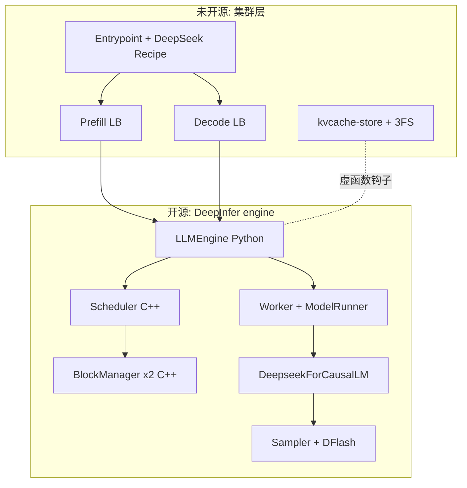
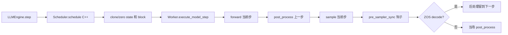
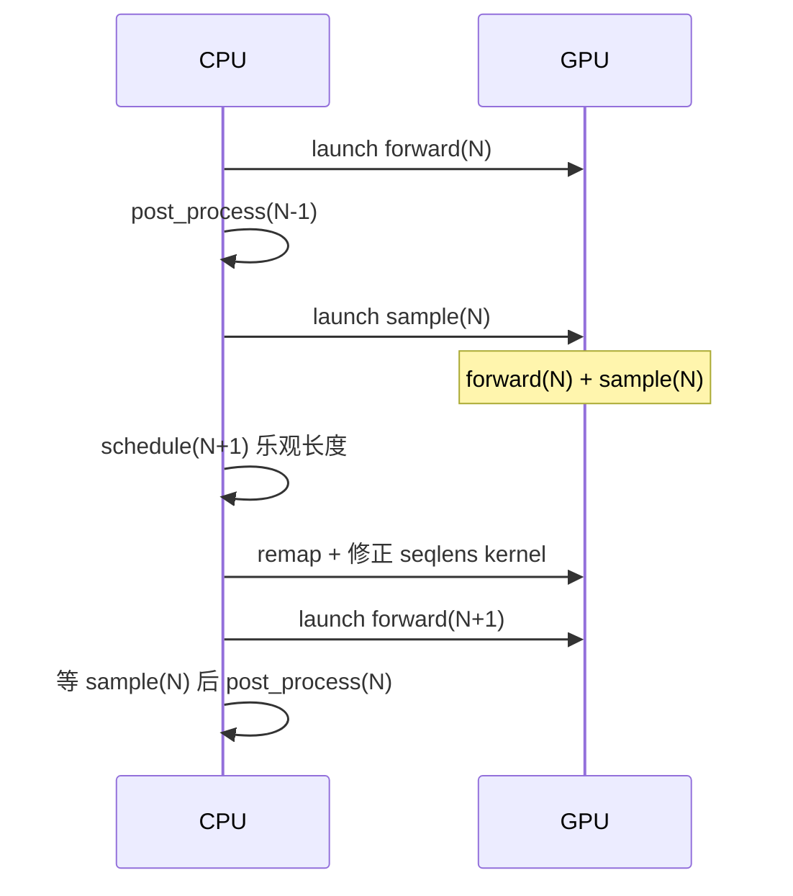

> 版本说明：本文基于 [deepseek-ai/DeepInfer](https://github.com/deepseek-ai/DeepInfer) 的 commit [`774ce244`](https://github.com/deepseek-ai/DeepInfer/tree/774ce244b87cc0eb8d4b94ab9f5de2ab22049f01)（2026-10-20，仓库首次公开当天）。配套文档是仓库里的 [inference_deployment_qa.md](https://github.com/deepseek-ai/DeepInfer/blob/774ce244b87cc0eb8d4b94ab9f5de2ab22049f01/doc/inference_deployment_qa.md)。文中的类名、默认值和常数只对这个版本负责。模型本身（CED、CSA2、FP4 KV、SWA Bounded Replay 的动机）在 [DeepSeek-V4.1-Flash 架构详解](/20260911/deepseek-v4-flash-inference-architecture/) 里已经讲过，本文只讲引擎。

## 1. 先说结论

DeepInfer 是 DeepSeek 线上服务 V4.1 Flash 用的推理框架。官方给的线上数字是单集群每天 155 万亿 token、每 GPU 小时收入 38 美元（谷时价）。这次开源的是**单个 engine 实例**：kernel、模型 runtime、调度器、采样器和投机解码。KV cache 存储系统、P/D/VE 解耦的编排层和各级负载均衡器没有开源，只在 Q&A 里给了设计说明。

读完代码，可以先记住八个事实：

1. 它最早从 vLLM 派生（文件头写着 `Derived from vLLM; modified by DeepSeek`），但调度器、序列状态、block 管理、输入准备全部重写成了 C++（`csrc/engine/`，pybind 暴露给 Python），Python 只留编排和模型。
2. 一个 step 要么全是 prefill，要么全是 decode，不做 vLLM 那种混合 batch。原因是 attention 用 DP、MoE 用 EP，同一个 EP 组里所有 DP rank 的步型必须一致，靠 DP 组内的 allreduce 投票决定。
3. decode 默认开启 ZOS（zero-overhead scheduling）：CPU 比 GPU 晚一步做后处理，下一步的序列长度在 CPU 上先按乐观值调度，再由 GPU 上的小 kernel 根据上一步的接收结果修正。整个 launch 路径用 `forbid_cuda_sync()` 守卫，不允许出现 CPU-GPU 同步。
4. 投机解码的 drafter 叫 DFlash：一次 forward 并行产出 5 个 draft，而不是 MTP 那样逐个自回归。它还带一个 confidence head，预测每个 draft 被接收的概率。
5. 验证长度是变长的（DSpark varlen）：调度器拿启动时实测的“batch token 数 → step 耗时”曲线，按 draft 的累乘接收率从高到低贪心加 token，选出期望吞吐最大的 total_q，再把这些名额分给各个请求。
6. KV 分两类管理：分页的 block KV（压缩后的 main KV 和 indexer K）走 `BlockManager`；SWA 窗口、压缩状态累加器等每序列固定大小的状态放在 `StateBlock` 槽位里，用第二个 `BlockManager` 管。两者分开是为了落盘：只有 block KV 和前 20 层 SWA 需要进存储。
7. prefill 的 YOCO 截断在模型 forward 内部实现：到第一个 consumer 层时把 metadata 切成 compact 视图，只保留末尾 140 个 query，但 consumer 层的 KV 仍然按全长写。
8. 开源版是离线推理入口（`LLM` / `LLMEngine.step()`），没有在线 server；硬件只支持 NVIDIA SM100 和昇腾 950。



## 2. 开源了什么，没开源什么

| 部分 | 状态 | 在哪 |
| :--- | :--- | :--- |
| FlashMLA / DeepGEMM / DeepEP / DeepSelect（含昇腾版） | 开源，git submodule | `vendor/` |
| TileLang 自定义 kernel（采样、压缩、KV 索引、CP mirror 等） | 开源，CUDA 和 Ascend 各一套 | `deepinfer/model_executor/layers/tilelang_ops/` |
| V4.1 模型 runtime | 开源 | `deepinfer/model_executor/models/` |
| 调度器、block 管理、输入准备、输出处理 | 开源，C++ | `csrc/engine/` |
| 异步调度、DFlash、变长验证、EPLB、结构化输出 | 开源 | `deepinfer/worker/`、`mtp/`、`eplb/`、`structure_output/` |
| KV cache 存储、P/D 传输、各级 LB | 未开源 | 只在 Q&A 和知乎博客里描述 |
| 在线 serving wrapper | 未开源 | README 明确说 |

`LLMEngine` 里留了一组空的虚函数：`init_pd_split`、`do_save_kvcache`、`pe_prepare_save_kvcache`、`pe_do_save_kvcache`、`send_processed_prompts`、`should_copy_state`。从名字和调用位置就能看出闭源部分怎么接进来：PE（prefill engine）在 prefill 步后处理时落盘，CE（completion engine）在 `pre_sampler_sync` 时落盘，`EngineType` 也分 `NORMAL / PROMPT / COMPLETION` 三种。开源版跑的是 `NORMAL`，同一个 engine 既做 prefill 也做 decode。

## 3. 线上部署是什么形状

这部分代码里没有，但它决定了引擎为什么这样设计，所以先过一遍 Q&A。

- E/P/D 三段解耦，加独立的存储节点。VE（vision encoder）一个实例一张卡，建议用便宜的卡。
- prefill：EP2–8 / DP2–8，在 HBM 放得下的前提下取最小值；用普通 8 卡机。
- decode：EP64–128 / DP64–128（Wide-EP），取能拿到的最大值；用 64–128 卡的超节点。
- 不用 TP，也不用 CP（CP 代码在，但线上没开）。
- P 和 D 的卡数大约 1:1，所以“高效的最小部署单元”是 64 卡 prefill 加 64 卡 decode。
- 因为 V4.1 的 KV 压得很小，P 和 D 可以跨机房，每 8 卡预留约 400 Gbps 互联。DeepSeek 实际把推理节点放在相邻的不同机房。

存储侧的数字：

- 每台 KV 存储服务器 20 块 30.73 TB SSD，至少 40 GB/s 读、5 GB/s 写，总容量至少能存 24 小时的数据。
- 按逻辑大小算，每张在线 GPU 对应约 14.4 TB 存储。
- 3FS 用 10+2 纠删码；读的时候同时向组内 11 个节点发请求，任意 10 个回来就能解码。
- 约 100 PiB SSD 给 KV cache。agent 流量 TTL 3 天，chatbot 7 天。chatbot 的命中长尾更重，TTL 缩到 3 天会掉 0.5%–1% 命中率。
- 匹配在 Entrypoint 做（hash 链前缀匹配，只查元数据，不能隐藏）；从 3FS 取 KV 到主机共享内存在单独进程里异步做；从共享内存换入 HBM 用 GDR，由 RDMA 网卡打满 PCIe，不占 SM。原因是 copy engine 处理 KV block 这种细粒度拷贝性能差。

这几条直接解释了代码里的几处选择：decode 一定是大 EP，所以步型一致性和 CPU 开销是首要问题；KV 一定要落盘，所以 state 布局要区分“要存”和“不存”。


## 4. 引擎骨架

### 4.1 进程模型

一个 DP rank 是一个独立进程，里面有一个 `LLMEngine` 和一个 C++ `Scheduler`。`examples/_launch.py` 按 `RANK / WORLD_SIZE` 把全局 DP rank 分到各节点，每个 rank 一个 spawn 子进程。EP 组横跨这些 DP 进程，MoE 的 dispatch/combine 走 DeepEP。

CP 开启时，一个 DP rank 内部再有 `cp_size` 个 worker：rank 0 是 driver，和 `LLMEngine` 同进程；其余 worker 由 `_init_workers` 用 `SpawnProcessWithCrashHeader` 拉起，进入 slave loop，等 driver 广播输入。

### 4.2 一个 step 的调用链



几个细节：

- `Scheduler.schedule()` 一进来就 `py::gil_scoped_release`，并同时锁住两个 `BlockManager`。调度期间不持 GIL，后台的结构化输出编译线程、多模态处理线程可以继续跑。
- 调度结果里的 `clone_states / clone_blocks / zero_states` 是借用 C++ 端 vector 存储的 numpy 视图，Python 必须在下一次 `schedule` 前消费完。这是为了省掉每步的分配和拷贝。
- `SequenceMetadataPool`、`RequestOutputPool` 都是对象池，step 的产物不在当步释放，而是交给 `DeferredRelease`，在下一步的 `pre_sampler_sync` 释放，这时 GPU 还在算，释放和计算重叠。

## 5. 调度器

调度器在 `csrc/engine/scheduler.hpp`，1300 多行，结构比 vLLM v1 简单很多。

### 5.1 步型投票：prefill 和 decode 不混

`NORMAL` 引擎每一步先决定这一步做 prefill 还是 decode。因为 DP attention 加 EP MoE 要求同一个 EP 组里各 DP rank 同时进同一种 forward（不然 DeepEP 的集合通信对不上，CUDA graph 也对不上），所以这个决定要全组一致：

- 只在两类“尝试点”考虑 prefill，其余 step 直接 decode。
  - ALL 点：每 `DEEPINFER_PREFILL_ATTEMPT_INTERVAL`（默认 70）个 decode step 一次。所有 rank 都有 prefill 要做才做，避免一个 rank 干活、其他 rank 陪跑空 prefill。
  - ANY 点：每 `DEEPINFER_PREFILL_ANY_ATTEMPT_INTERVAL`（默认 100）个 decode step 一次。只要有一个 rank 想做就一起做，给孤立 rank 兜底。
- 本 rank 是否“想做”：GPU cache 使用率不超过 0.9，且 waiting 队头可调度。
- 投票就是 DP 组内一次 `allreduce(MIN)`。投完还有第二轮：确认确实有 rank 排出了 prefill（`want` 只看了队列非空，可能因为 slot 满或 block 不够而空手）。全组都空手就转 decode，否则 running 满加 waiting 非空会卡在“投票 → 空 prefill → 投票”的死循环里。
- 本 rank 没活但组里有人做 prefill 时，本 rank 返回一个空的 prompt step 陪跑。

这和 vLLM 的 chunked prefill 混合 batch 是两种思路。DeepInfer 把 decode 当作主流程，prefill 是每几十步插入一次的“打断”。线上是 P/D 解耦的，`PROMPT` 引擎只走 `_schedule_prefill`，`COMPLETION` 引擎只走 `_schedule_decode`，这套投票只在 `NORMAL` 引擎（开源版的默认形态）里生效。

ZOS 开启时，这些投票走 gloo 的 CPU DP 组（`PG.cpu_data_parallel_group()`），不走 NCCL，否则投票本身就会引入一次 GPU 同步。

### 5.2 prefill 调度

`_schedule_prefill` 是 FIFO，按顺序看 waiting 队头：

1. 已经判死的请求（abort、VE 失败、结构化输出编译失败）直接放进 `ignored_seqs` 带回去。
2. 首次调度时检查长度和容量。block 和 state 是联合分配的：state 开不出来时也视为 `LATER`。
3. 受三个上限约束：`max_num_batched_tokens`、`max_num_prompts`，以及一个单独的 `prefill_max_sum_seqlen_k`（本步所有序列的 K 长度总和上限，用来限制 attention 的工作量）。
4. 超出 token 预算时切 chunk，切点有三个修正：CP 开启时按 `2 × cp_size` 对齐；有 `chunk_checkpoints` 时切在检查点上；多模态时不能切在一张图的 `IMAGE_PAD` 中间，要么整图挪到下一块，要么（本步还没有别的请求时）把整张图吞进来。
5. 一个请求被切成 chunk 后，`NORMAL` 引擎本步不再加入别的请求。

注意一个和 Q&A 对不上的地方。Q&A 说线上 prefill 每步有时间预算（`compute_quota_limit`，纳秒），用拟合的二次代价模型 `cost(q, c)` 反解出 chunk 大小，并在 DP 组内 allreduce MIN。开源代码里没有这条路径：chunk 只由 token 数决定。`FlopsEstimator` 在调度时被调用，但只在 `log_stats` 打开时累加 FLOPs 做 MFU 统计，不参与决策。代价模型应该在未开源的 PE 子类或 LB 里。

### 5.3 decode 调度

`_schedule_decode` 的逻辑：

1. 先把 `prompted` 队列里的序列转进 `running`（PE 送来的、或者 fork 出来的）。fork 的序列要先克隆 state 和最后一个可能写了一半的 block。
2. `running` 按已输出长度降序排，从输出最短的一端开始挑（代码注释写的是 LCFS）。每个被选中的序列 `_append_slot` 补一个 block；block 不够就从另一端（输出最长的）抢占。
3. 抢占的默认行为是**直接结束请求**：`EngineArgs.stop_preempted_request` 默认 `True`，被抢占的请求标成 `FINISHED_PREEMPTED`。`COMPLETION` 引擎没有 prefill 通道，构造函数里直接拦截了“CE + 允许重算”这个组合。结构化输出的请求也不支持重算，一律结束。
4. 选完后按总长度降序排，交给 `MTPVarlen` 分配每个请求的验证长度（见第 7 节）。

“抢占即结束”和线上的条件是一致的：Q&A 说 decode 不受 cache 容量限制（V4.1 的 KV 很小），抢占本来就少见；而 CE 没有 prefill 通道，本地也没法重算。Q&A 提到容错靠“请求级重路由”，被结束的请求应该由上层处理，这部分代码不在仓库里。

### 5.4 BlockManager

`BlockManager` 只有不到 250 行：

- 空闲块是一个用数组实现的双向链表，`allocate` 从头取，`free` 到尾。
- 每块一个 `ref_count`，fork 时 `pin_blocks` 给共享块加引用。
- 0 号块保留不分配，block table 里的 0 表示“空”，CUDA graph 的 padding 行也写到这里。
- 没有 hash，没有前缀索引，没有 LRU。前缀复用只有两种方式：外部 KV store 换入（未开源），或者引擎内 `fork_seq` 显式分叉。

`fork_seq` 用来做同前缀的多分支（比如 benchmark 里先算一个公共前缀，再分出 N 个请求）：新序列共享父序列的 block table 并 pin 住，state 也 pin 住；真正调度到时再做写时复制，只拷贝最后一个没写满的 block 和 state 槽位。分支 id 以 `_` 开头表示“还没复制”，复制后去掉前缀。

## 6. ZOS：零开销异步调度

### 6.1 要解决的问题

一个同步的 decode step 是：

```text
schedule(N) -> forward(N) -> sample(N) -> [sync] -> post_process(N) -> schedule(N+1) ...
```

`post_process(N)` 要拿到 `sample(N)` 的结果，所以有一次 GPU→CPU 同步，同步之后到下一次 forward 发射之前，GPU 是空的。大 EP 的 decode step 本身只有十几毫秒，CPU 的几毫秒占比很可观。

ZOS 的流水是：GPU 跑 `forward(N) → sample(N)` 的同时，CPU 做 `schedule(N+1) → launch_forward(N+1) → post_process(N−1) → launch_sample(N+1)`。这和 SGLang 的 overlap scheduler、NanoFlow 是同一类做法，Q&A 里也说明了参考来源。

### 6.2 代码里的实现

`Worker.execute_model_step` 是所有 step 的唯一入口，固定做四件事：

```python
# 1. forward 当前步（只发射，不等）
main_model_output = self.model_runner.execute_main_model(...)
# 2. 后处理上一步：此时才 synchronize 上一步的 sample_end_evt
request_outputs = self._post_process_step(self.prev_step_state)
# 3. sample 当前步
sampler_output = self.model_runner.execute_sample(...)
# 4. prompt 步或关闭 ZOS 时当场后处理；ZOS decode 步存进 prev_step_state
```

难点在第 1 步：CPU 调度 N+1 步时还不知道 N 步每个请求接收了几个 token，所以序列长度、输入 token 都是错的。DeepInfer 的处理方式：

- **调度时乐观预留。** 每个序列维护 `total_inflight_tokens`，调度时按 `max_seqlen_q = nextn + 1` 预留，`get_num_blocks()` 把这部分算进去。`runtime_max_model_len` 也相应加上 `nextn + (nextn + 1)` 的调度余量和 `nextn` 的 draft 余量，RoPE cache 等按位置索引的 buffer 都按这个长度分配。
- **GPU 上修正长度。** `prepare_zos_inputs`（C++）比较本步和上一步的序列列表，生成 `remap`：本步第 i 个序列在上一步的下标，新序列为 −1。顺序完全相同时走快路径。然后在 GPU 上跑两个小 kernel：`compute_seqlens_q_by_confidence_rates` 按上一步的 confidence 重新分配验证长度，`compute_seqlens_k_zos` 按上一步的 `num_accepted_tokens` 修正 K 长度。
- **GPU 上取输入 token。** 有 remap 的行，输入 token 直接从上一步 GPU 上的 `sampled_token_ids / predict_token_ids` 里取；只有新序列（remap = −1）的输入由 CPU 填进 pinned buffer。Engram 的 n-gram 窗口也是同样处理：CPU 只填历史部分，最新的几个 token 在 GPU 上拼。
- **采样前补齐 CPU 元数据。** 修正后的 `seqlens_q` 异步 D2H 拷回 pinned buffer，采样前等这个 event，再用 `update_metadata_for_sampling_zos` 把 CPU 侧的 `seqlen_q / seqlen_k` 改对。这次等待只等一个很小的拷贝，不等 forward。

`execute_main_model` 和 `execute_sample` 都包在 `forbid_cuda_sync()` 里，任何隐式同步（比如某处 `.item()`）都会直接报错，调试时可以用 `DEEPINFER_DISABLE_SYNC_GUARD` 关掉。这是保证流水不被意外打断的工程手段。

默认值：`NORMAL` 和 `COMPLETION` 引擎默认开 ZOS，`PROMPT` 引擎默认关（`EngineType.default_zero_overhead_scheduling`）。prefill 步本来就在当场后处理，开 ZOS 没有收益。



## 7. 投机解码：DFlash 和变长验证

### 7.1 DFlash：并行 drafter

V4.1 Flash 的 draft 模块不是 V3 那种逐 token 自回归的 MTP。`DFlash` 的结构：

1. 主模型 forward 时，从若干个 target 层（`dspark_target_layer_ids`）抓 hidden，拼起来过一个投影和 norm，再用合并后的 `main_kv_proj` 一次算出所有 draft 层的 key，写进 draft 层自己的 SWA cache。这一步在主模型 forward 里做，decode 时随主模型 CUDA graph 一起 replay。
2. draft forward 时，每个请求的输入是 `[golden_token, noise, noise, noise, noise]`（`noise_token_id` 填充，块长 = `DEEPINFER_USE_NEXTN_DECODE`，默认 5），一次 forward 并行算出 5 个位置的 hidden。
3. 采样阶段逐位置做：logits 加一个低秩 Markov 修正（`markov_w1` 是 embedding，`markov_w2` 投回词表，输入是上一个 draft token），再采样；同时 `ConfidenceHead` 用 hidden 和 Markov embedding 预测这个 draft 被接收的概率。

update_main_cache 的 docstring 里有一个值得注意的推理：decode 时接收结果还没出来，所以所有 token 的 key 都照写；被拒绝的 draft 位置，恰好就是下一次 `forward_drafts` 要写 draft key 的位置，在任何读取之前就会被覆盖，所以不需要按接收结果做屏蔽。这省掉了一次依赖接收结果的同步。

回退也不需要拷贝：SWA ring 的长度是 `window_size + DEEPINFER_MAX_BACKTRACKING_TOKENS`，后者至少是 `nextn + 1`。被拒绝的 token 写进 ring 多出来的槽位，下一步覆盖即可。压缩状态的 ring 同理，长度是 `compress_ratio + max_backtracking − 1`。

### 7.2 变长验证怎么选长度

固定验证 5 个 draft 会把算力浪费在接收概率很低的位置上。`MTPVarlen::schedule` 的做法：

1. 启动时 `profile_decode_perf` 对每个 CUDA graph 尺寸 replay 5 次，去掉最高最低取平均，再在 EP 组内取均值，得到 `(graph_size, forward_ms)` 曲线。结果按模型和并行配置做 hash 缓存到文件。
2. 运行时用两个在线估计器修正这条曲线：`ForwardRuntimeEstimator` 用最近 5000 步拟合一个“每 token 额外耗时”的斜率（启动曲线没考虑上下文长度），两层中位数，抗离群值；`SamplerRuntimeEstimator` 按 batch 内序列数记最近 9 次 sampler 耗时的中位数。
3. 把所有请求的所有 draft 位置展开成 `(累乘接收率, 请求下标)`，按接收率降序排。累乘保证同一个请求内部的接收率单调递减，所以排序后取前缀，每个请求得到的一定也是自己 draft 的前缀。
4. 从“只验证 golden token”开始，逐个加入 draft，每加一个算一次期望吞吐 `期望 token 数 / (曲线[graph_size] + slope × graph_size + sampler_ms)`，取最大的那个 total_q。
5. 前 `total_q − num_seqs` 个名额按排序分给各请求。

这里有一个时序上的处理：第 N 步调度时，用 N−2 步的接收率决定 total_q，用 N−1 步的接收率决定每个请求分多少。原因是在 ZOS 下，CPU 在调度 N 时 N−1 步的 confidence 还没回来；`total_q` 必须在 CPU 上确定（它决定选哪个 CUDA graph），而每请求的分配可以留给 GPU 上的 kernel 用最新的 confidence 重算。GPU 版本就是 `compute_seqlens_q_by_confidence_rates`：cumprod、全局 argsort 取 top-k、按请求计数，再把 remap 的 scatter 融合进去。

CUDA graph 按 **total_q**（token 数）而不是请求数捕获。`build_graph_batch_sizes` 先是 1、2、4…到间隔值，再按 `DEEPINFER_CUDAGRAPH_BATCH_SIZE_INTERVAL`（默认 8）等距到最大值。变长验证选出的 total_q 向上取到最近的 graph 尺寸，padding 行指向 0 号 block 和 0 号 state。

Q&A 给的效果（EP64/DP64，草稿长度 5）：

| 每 rank 并发 | 固定 5 平均验证长度 | 变长平均验证长度 | 固定 5 接收长度 | 变长接收长度 | 吞吐变化 |
| ---: | ---: | ---: | ---: | ---: | ---: |
| 16 | 5 | 4.44 | 3.32 | 3.24 | −1.5% |
| 32 | 5 | 3.65 | 3.25 | 3.17 | +1.6% |
| 60 | 5 | 3.58 | 3.30 | 3.21 | +5.4% |
| 96 | 5 | 3.24 | 3.30 | 3.15 | +11.0% |

规律很清楚：并发低时 step 耗时对 token 数不敏感，多验证几个几乎免费，变长反而略亏；并发越高，曲线越陡，砍掉低价值的验证越划算。线上工作点约每 rank 60 并发，收益 4%–7%。

## 8. KV 和 state 的布局

### 8.1 两种存储

`cache_engine.py` 里每层的 `KVCache` 有五个字段：

| 字段 | 内容 | 管理方式 |
| :--- | :--- | :--- |
| `ca_cache` | 压缩后的 main KV，`[num_blocks, block_size / ratio, 1, bytes]` | 分页，`BlockManager` |
| `ica_cache` | indexer 的 K（MXFP4） | 分页，`BlockManager` |
| `swa_cache` | SWA 窗口 ring，`[num_state_seqs, swa_block_size, 1, 528]` | 每序列一个槽，`state_manager` |
| `ca_state` | 压缩累加器（fp32） | 同上 |
| `ica_state` | indexer 压缩累加器（fp32） | 同上 |

每 token 的字节数：main KV 用 per-16 e4m3 的 FP4 时是 288 B，SWA 用 MXFP8 是 528 B（512 B 数据加 16 B UE8M0 scale）。所有层的 block KV 在一个大的 uint8 buffer 里按层拼接，每层 32 字节对齐，整体按 DeepGEMM 要求的 128 字节和每 token 字节数的公倍数对齐。share-kv / share-index 的层不占新空间，直接引用前面层的 tensor。

state 槽位数是 `max_num_seqs × DEEPINFER_NUM_STATE_SLOTS_RATIO + 1`，默认比例 1.2，加 1 是 0 号 dummy 槽。比 `max_num_seqs` 多出来的部分，可以给 fork 的写时复制等需要临时多占一个槽的场景用（代码没有注释具体用途，这是我的推断）。

### 8.2 StateBlock：为落盘设计的分区

一个序列的 state 槽从低地址到高地址是：

```text
[stored region: 前 n_prefill_layer 层的 SWA]
[dropped region: YOCO consumer 层的 SWA | 压缩累加器]
```

- 落盘只截取前 `state_size_to_disk` 字节。V4.1 是 20 层 × 134 token × 528 B = 1,415,040 B，134 = 128 窗口 + 6 个回退余量。
- consumer 层的 SWA 不存，靠 prefill 时的有界重算恢复。
- 压缩累加器不存，因为压缩窗口的边界天然对齐到 128 的落盘粒度（`KVSTORE_GRAIN = 128`），落盘点上没有跨边界的未完成累加。
- PE→CE 传输时两个区都要传，consumer SWA 需要按 ring 重排。

kvstore 视角的 SWA ring 比推理视角更长：`DEEPINFER_PREFILL_STORE_EXTRA_SIZE` 加上 YOCO 保留的 token 数。原因是 prefill 只在 128 的倍数处落盘，最后一个 chunk 可能不触发落盘，多存一段才能保证下一轮能命中。

这种“按是否落盘分区”的布局让存储路径不用理解模型结构：落盘就是一次固定长度的 memcpy。

## 9. YOCO 截断：在 forward 里切 metadata

V4.1 的 CED 结构里，decoder（consumer）层的 block KV 由最后一个 encoder 层的 hidden 投影出来，consumer 层自己只需要 SWA。所以 prefill 时 consumer 层只算最后一小段 query 就够了，前提是 consumer 层的 KV 仍然覆盖完整上下文。

开启方式是 `DEEPINFER_YOCO_PREFILL_TRUNCATION_MODE=compact` 和 `DEEPINFER_YOCO_PREFILL_KEEP_TOKENS=140`。140 要覆盖 SWA 窗口加最大回退长度。

实现分散在三处：

1. `DeepseekModel.forward` 循环到 `i == n_prefill_layer` 时，把 `input_metadata` 换成 `get_consumer_view()`（compact 视图），原来的 full metadata 存进 `cross_layer_runtime.consumer_full_metadata`。
2. 第一个 consumer 层里，`compact_yoco_boundary` 用 gather 把 hidden、残差（包括 mHC 的 lazy post 数据）、跨层共享的 top-k 索引都压到保留下来的行上。CP 开启时，每个 rank 只持有部分 token，要先挑出本 rank 上仍然存活的行，all-gather，再按新的 CP 切分取回本 rank 的部分。
3. `V4Attention.forward` 发现 `consumer_full_metadata` 不为空时，走 `_store_yoco_full_kv`：用全长的 shared hidden 生成并写入 main/index KV，后面主路径跳过 KV 更新，只用 compact 的 query 做 attention。

几个约束写在 `_init_yoco` 的断言里：DFlash 的 target 层必须全在 consumer 一侧或全不在；Engram 不能出现在 consumer 层；截断模式下 prompt logprobs 被强制关闭（被截掉的行算不出来）。

另一个模式是 `mask`：保留全部 query，只把 SWA 可见域收窄到末尾的矩形，结果和 compact 等价但不省计算，用来对拍。`examples/yoco/yoco_equiv.py` 就是做这个对拍的。

## 10. 并行与通信

- **Attention DP + MoE EP。** MoE 层用 DeepEP 的 `EPBuffer` 做 dispatch/combine；GPU 上默认走 DeepGEMM 的 Mega MoE（`fp8_fp4_mega_moe` 或 `bf16_mega_moe`）：输入写进 symmetric memory buffer，一次调用完成跨卡分发、两次 GEMM、SwiGLU 和回收，shared expert 也可以融进去，专家负载统计在同一次调用里累加给 EPLB。gate 单独一个 `bf16_mega_gate`。Q&A 的说法是 Mega MoE 在一个 scale-up 域内不论 EP 大小和 batch 大小都明显快于非融合版本。专家权重是 MXFP4，per-32 UE8M0 scale。
- **EPLB。** 每张卡在负责的专家之外放几个冗余专家，承载热点专家的副本。冗余数取不小于下限、且让物理专家总数能被 `ep_size` 整除的最小值。按最近 N 步的负载统计，每 M 步重新分配，权重在组内通过 NVLink `symm_mem` 搬运。线上参数：prefill 每卡 4 个冗余、100 步窗口、1000 步重排，`moe_lb`（最慢 rank / 平均）1.045–1.074；decode 每卡 1 个冗余、1000 步窗口、10000 步重排，`moe_lb` 1.090。同构的 MoE 层（包括 DFlash 的 MoE 层）分组共用一个 balancer。
- **CP（balanced / mirror）。** prefill 的 CP 用 mirror 切分：每条序列切成 `2 × cp_size` 段，rank i 拿第 i 段和倒数第 i 段，让 causal attention 的工作量在 rank 间均衡。`prepare_cp_mirror` 是一个 TileLang kernel，一次算出正向和反向索引，以及每种压缩比下的 KV 起止位置。线上目前不用 CP。
- **PDL。** `runtime_config.py` 对 DeepGEMM 和 TileKernels 统一打开 programmatic dependent launch，让相邻 kernel 的尾部和头部重叠。
- **userbuffer。** CP 的 all-gather、EP 通信使用预分配的 userbuffer 和固定 SM 数（`DEEPINFER_USERBUFFER_COMM_SMS`）。

## 11. 确定性、结构化输出和其他

- **Batch invariance。** `DEEPINFER_BATCH_INVARIANT=1` 时 attention 走 batch-invariant 的 kernel 路径，DeepGEMM 和 TileKernels 打开确定性算法；开了 EPLB 重排时 userbuffer 禁止多次 reduction。再关掉变长验证、给 `SamplingParams` 传固定 `seq_seed`，就能做到相同输入和采样参数得到相同输出。目前只支持 NVIDIA。变长验证会让一个请求的验证长度依赖同 batch 的其他请求，所以和确定性互斥。
- **结构化输出。** 用 xgrammar。编译是异步的：`SOMatcherBuilder` 在空闲 CPU 上开线程池编译 grammar，编译完回调把请求放进 waiting 队列，引擎在 `pre_sampler_sync` 里 `pump()` 一次。线上编译放在专门的 SO 机器上。
- **采样。** 采样、top-k/top-p、logprobs、draft 采样都是 TileLang kernel，`DEEPINFER_SAMPLER_FORCE_TOPK` 可以只保留 top-k 的 logprobs 以省显存。
- **多模态。** `MultimodalProcessor` 在 fork 出的子进程里处理图片，通过共享内存池（`SharedTorchMemoryPool`）把结果交给引擎；VE 失败的请求标记 `FINISHED_VE_FAILED`，由调度器在 decode 分支兜底清理。
- **Engram。** 输入除了 token id 还有压缩词表下的 n-gram 窗口，`engram_hash` kernel 在 forward 开头算 hash 并预取 embedding，注入到对应层。

## 12. 和 vLLM / SGLang 的差异

| 维度 | DeepInfer | vLLM v1 | SGLang |
| :--- | :--- | :--- | :--- |
| 调度器语言 | C++ | Python | Python |
| prefill/decode 混合 | 不混，DP 组投票 | 混合 batch | 可配，默认分开 |
| 前缀缓存 | 引擎内无，靠外部 store 和 fork | hash 前缀缓存 | radix tree |
| 抢占 | 默认结束请求 | 重算 | 重算 |
| CPU/GPU 重叠 | ZOS，GPU 上修正长度 | async scheduling | overlap scheduler |
| 投机解码验证长度 | 按接收率和实测曲线动态选 | 固定 | 固定 |
| CUDA graph 键 | total_q（token 数） | token 数 | batch size |
| 模型支持 | 只有 V4.1 Flash | 通用 | 通用 |

DeepInfer 的取舍可以概括为：只服务一个模型、一种部署形态，所以敢把通用框架里的很多抽象拿掉。没有 attention backend 选择、没有通用的 KV 管理器、没有前缀缓存，调度器只有两条路径。换来的是可以针对 V4.1 的 KV 形状、DSpark 和大 EP 做到很细，比如 SWA ring 的回退余量、按落盘需求分区的 state 布局、和 CUDA graph 尺寸联动的验证长度选择。

## 13. 局限和读代码时要注意的地方

- **只支持 DeepSeek-V4.1-Flash。** 模型代码直接按 V4.1 的 HF 模块结构取权重，换模型要重写 `model_executor/models/`。
- **硬件门槛高。** NVIDIA 只支持 SM100（B200 / GB200 级别），需要 CUDA 13、GCC 13、Python 3.12；昇腾只支持 950。
- **开源版是离线推理。** 没有 HTTP server，没有 P/D 传输，没有 KV store。想搭完整服务，需要自己实现那组虚函数和外部组件。
- **文档和代码有出入。** Q&A 描述的 prefill 时间预算和二次代价模型、GDR 换入、SWA 的跨机目录，开源代码里都没有。读 Q&A 时要区分“线上系统怎么做”和“这个仓库能做什么”。
- **性能数字的口径。** README 的 decode 吞吐图是“全接收口径”：`avg_SPS × 请求数 × (1 + nextn)`，不管实际接收率。比较时要换算成真实接收长度（线上约 3.2）。
- **最小高效部署单元是 128 卡。** decode 要 EP64 以上才能发挥 Wide-EP 的收益，单机 8 卡能跑，但不代表线上效率。

## 参考

- [deepseek-ai/DeepInfer](https://github.com/deepseek-ai/DeepInfer)，commit `774ce244`
- [DeepSeek V4.1 Flash Inference Deployment Q&A](https://github.com/deepseek-ai/DeepInfer/blob/774ce244b87cc0eb8d4b94ab9f5de2ab22049f01/doc/inference_deployment_qa.md)
- [deepseek-ai/deepseek-recipe](https://github.com/deepseek-ai/deepseek-recipe)
- [DeepSeek-V4.1-Flash 模型卡](https://huggingface.co/deepseek-ai/DeepSeek-V4.1-Flash-1017)
- [DeepSeek-V4.1-Flash 架构详解](/20260911/deepseek-v4-flash-inference-architecture/)
- [vLLM 调度器与 continuous batching](/20260508/vllm-scheduler-and-continuous-batching/)
