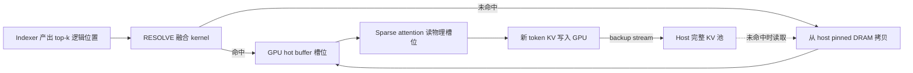
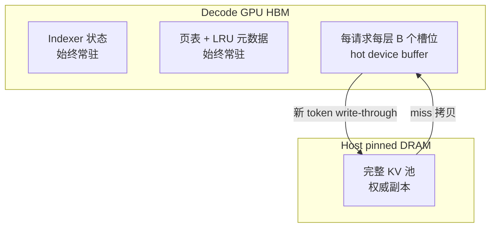
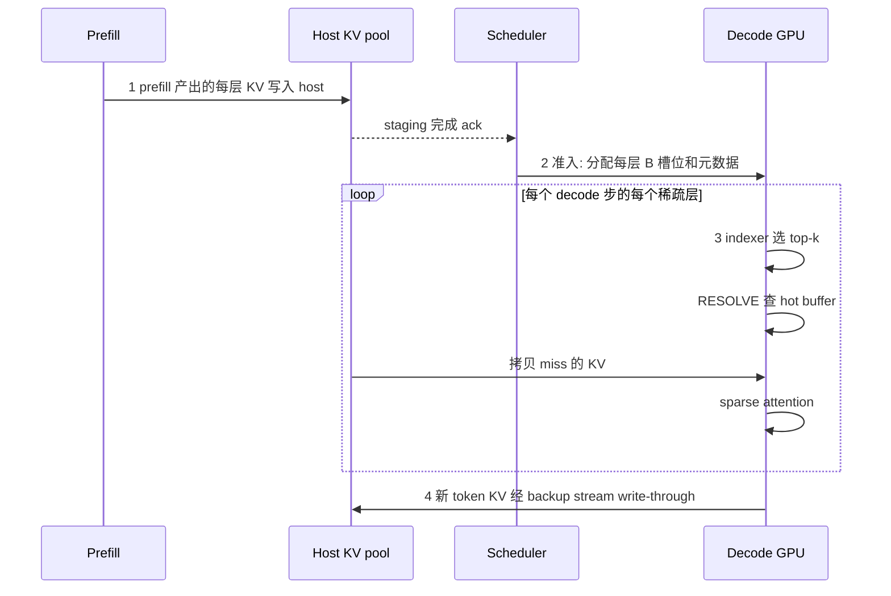
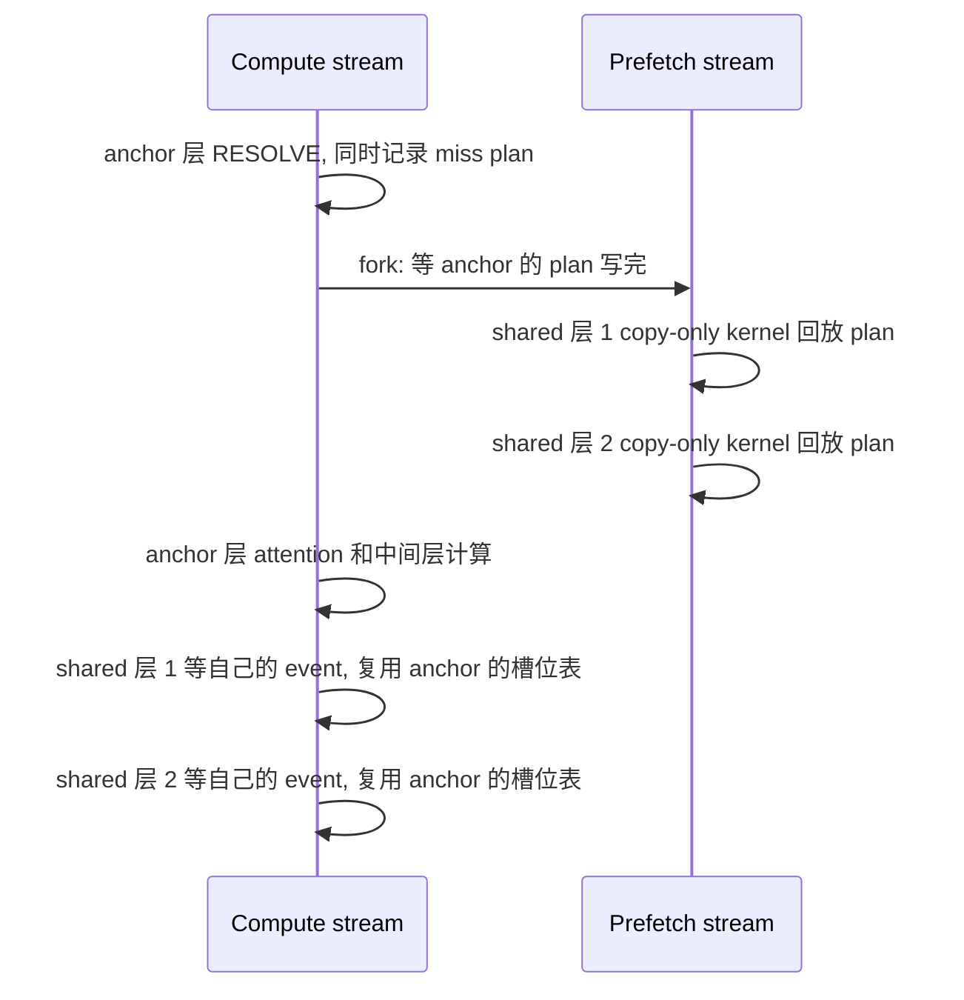
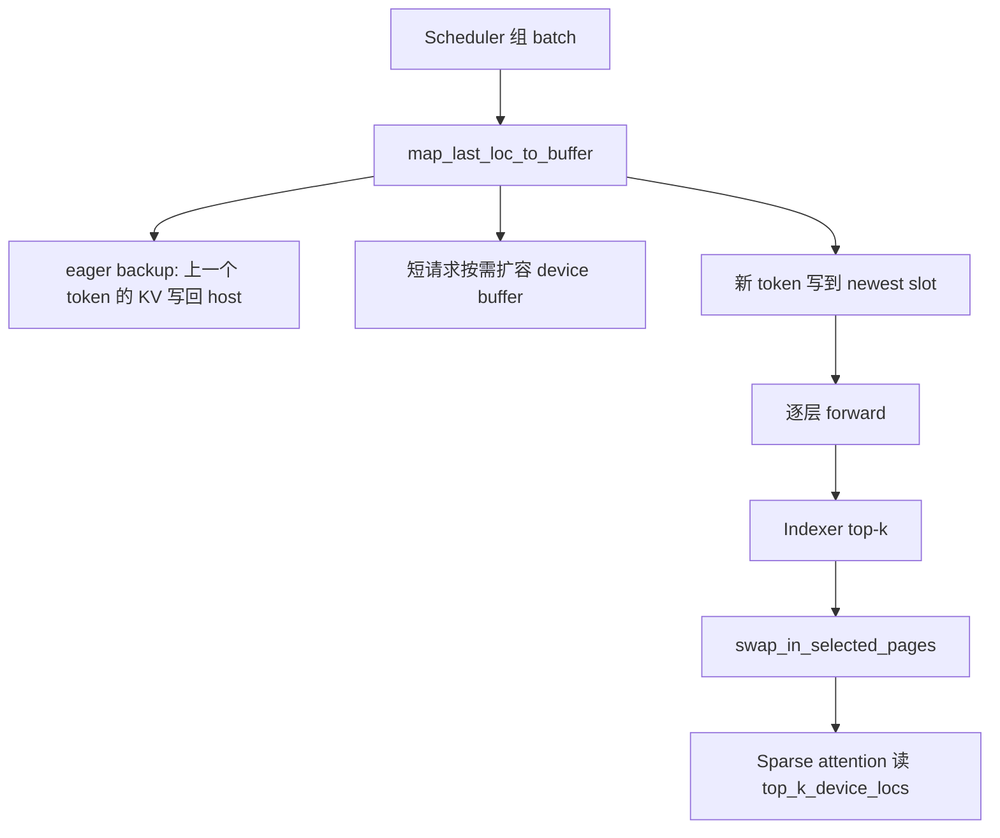
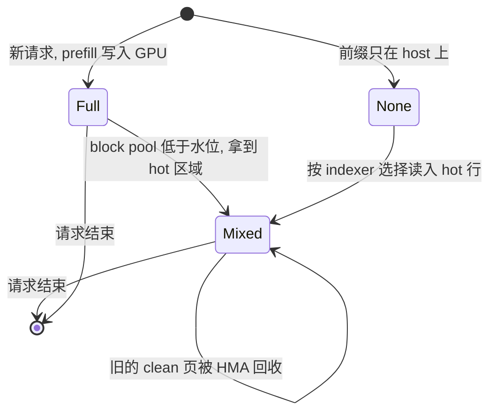
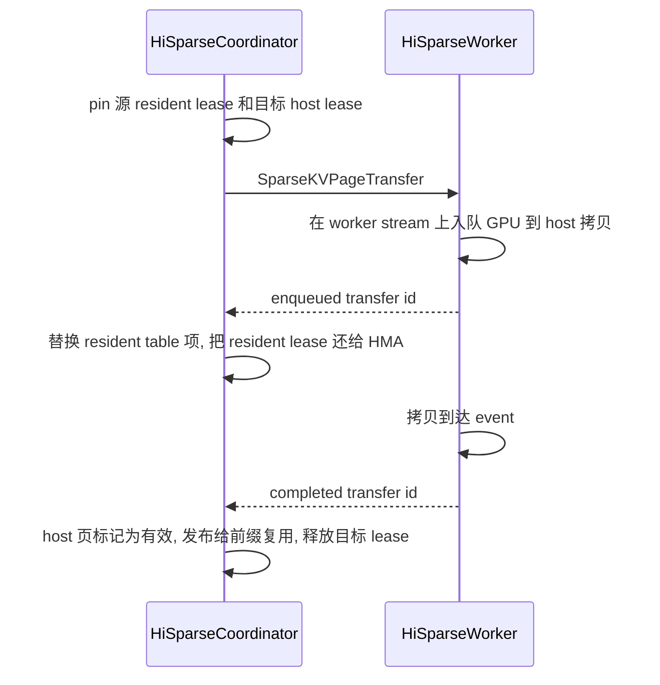

> 版本说明：论文部分基于 arXiv [2608.07009v1](https://arxiv.org/abs/2608.07009)（2026-08-07）。SGLang 部分基于 upstream commit [`41fb719c`](https://github.com/sgl-project/sglang/commit/41fb719cf25966e6155f3e3d91f1157bc1a15123)（2026-10-27），vLLM 部分基于 upstream commit [`28974013`](https://github.com/vllm-project/vllm/commit/289740137027e1d91490fcf9a48490a8a712e200)（2026-10-27）。两个仓库里 HiSparse 都标为 experimental，类名、参数和约束只对这两个版本负责。

## 1. 先说结论

HiSparse 要解决的问题可以用一句话概括：top-k 稀疏注意力每步只读 k 个 KV，但服务系统仍然把完整上下文的 KV 留在 HBM 里，所以容量账单没有因为稀疏而变小。

它的做法是把“逻辑上可被选中”和“物理上在 GPU 上”拆开：

- 完整 KV 放在 host pinned DRAM，作为权威副本。
- 每个请求、每层只在 GPU 上保留一个固定大小的 hot buffer，容量记作 B（B ≥ k，推荐 2k–4k）。
- 每层 indexer 选出 top-k 之后，一个融合 CUDA kernel 查 hot buffer：命中直接用，未命中从 host 拷进来，同时用 LRU 选出要替换的槽位。
- 新 token 的 KV 先写进 GPU，再由后台 stream write-through 到 host。
- 对 GLM-5.2 这类跨层共享 index 的模型，anchor 层算出 miss plan 后，后面的共享层在 side stream 上按同一份 plan 精确预取。



几个关键数字：

| 项目 | 数值 | 来源 |
| --- | --- | --- |
| 单请求解码期 KV 占用 | GLM-5.1 128K 上下文：13.09 GB 降到约 0.4 GB（B=4096） | 论文 §3.3 |
| LRU 命中率 | B=2k 时 miss 13.4%，FIFO 17.2%，random 16.1%，Bélády 8.2% | 论文 §4.3 |
| 峰值吞吐提升 | 最高 4.7×（Qwen3-30B-A3B + Quest，200K） | 论文 §4.2 |
| 精确预取 | TPOT 降 13–15%，达到 no-IO oracle 吞吐的 85% | 论文 §4.6 |
| resolve 本身的开销 | no-IO oracle 的 TPOT 与 baseline 持平（24.1 vs 24.8 ms），开销全部来自 IO | 论文 §4.6 |

两个实现的定位不一样：

- SGLang 是论文的原生实现。HiSparse 管的是 decode 期每个请求的工作集，请求一进入 decode，就整体切到“host 权威 + GPU hot buffer”模式。
- vLLM 的 Hybrid HiSparse 是一个 residency policy。KV 默认仍在 GPU 上，只有 HMA block pool 吃紧时，才按页把旧页让给 host，被选中的行通过 hot page 读回来。没有压力时它不产生任何 CPU↔GPU 读流量。

## 2. 问题：稀疏注意力的容量墙

### 2.1 top-k 稀疏注意力的共同接口

论文把三类选择器放在同一个接口下讨论：

| 选择器 | 选择状态 | 粒度 | 是否需训练 |
| --- | --- | --- | --- |
| DSA（DeepSeek-V3.2、GLM-5.x） | 每 token 一个紧凑 indexer key | token | 与主干共同训练 |
| NSA / DeepSeek-V4 CSA | 每个 token block 一个压缩 key | block | 训练 |
| Quest | 每页 key 的 min/max 摘要 | page | 无需训练 |

它们有三个共同性质，HiSparse 就建立在这三点之上：

1. 选择状态很小，可以常驻 HBM。indexer key 加页表每 token 最多几百字节，而 KV 记录每 token 约 100 KB（跨所有层合计）。
2. 选择先于 attention 完成。indexer 输出之后、attention 读 KV 之前，有一个天然的插入点。
3. 输出形式统一，都是一组逻辑 token 位置 $S_t^{(\ell)}$。

所以 HiSparse 是 indexer-agnostic 的：它只消费“第 ℓ 层第 t 步选了哪些位置”，不关心这些位置是怎么算出来的。

DSA 和 V4 混合 KV 的细节可以参考之前的笔记 [DeepSeek DSA、V4 与 Hybrid KV Cache](/20260508/deepseek-dsa-v4-and-hybrid-kv-cache/)。

### 2.2 容量墙的算术

设一个 decode batch 有 $N_{batch}$ 个请求，上下文长度 $L_{ctx}$，那么：

- HBM 必须放下 $N_{batch} \times L_{ctx}$ 个 token 的 KV；
- 每步 attention 只读 $N_{batch} \times k$ 个 token 的 KV。

论文用 GLM-5.1-FP8（BF16 KV）在 8×H200 上的数字说明这件事：

- 32K 输入 / 8K 输出时，每请求最多约 4 GB KV。扣掉权重、激活和 CUDA graph，剩下约 240 GB 给 KV，baseline 大约在 60 并发处饱和。
- 128K 时同样的 HBM 只能放下约 15 个请求。
- 1M 上下文的单个请求需要超过 100 GB KV，加上权重后一张 H200 根本放不下。

饱和之后，PD 分离部署里 decode 池吞吐被直接封顶（论文测得 decode-only 777 tokens/s）。PD 混部时，decode KV 挤占 prefill 需要的显存，TTFT 会被排队时间主导，急剧上升。

### 2.3 为什么不能直接全量 offload

把可用性和驻留拆开后，最朴素的做法是：KV 全放 host，每层每步把 k 个选中的 KV 拷上来。论文算了这笔账：

- GLM-5.1 每 token 跨层约 100 KB KV，k=2048，每生成一个 token 要搬约 200 MB；
- TPOT 30 ms 时，每请求需要约 7 GB/s 的持续 H2D 带宽；
- PCIe Gen5 x16 单向约 64 GB/s，一张卡十几个并发请求就把链路打满了。

让这件事变得可行的是选择的局部性：相邻 decode 步选中的位置高度重叠，相邻层选中的位置也相关。在 LongBenchV2 的选择轨迹上，B=2k 的 LRU cache 能让 87% 的选择直接命中 GPU。

按 13.4% 的 miss 率粗算，每 token 的 IO 从约 200 MB 降到约 27 MB，同样一条 PCIe Gen5 链路能撑住的请求数从十几个变成几十个。这是我按论文给的平均值做的估算，没有算突发 miss 和多请求并发争用；论文 §4.4 的实测也表明，batch 变大时 IO 段增长得很快。

## 3. 论文设计

### 3.1 设计目标和不变量

| 目标 | 含义 |
| --- | --- |
| 完整可用 | 每个活跃请求在 decode GPU 的 HBM 之外有一份完整 KV，任何被选中的位置都不需要重算 |
| 有界占用 | 每请求每层固定 B 个槽位，解码期 KV 占用从 $N_{batch} N_\ell L_{ctx} W_{KV} s$ 变成 $N_{batch} N_\ell B W_{KV} s$ |
| 结果精确 | attention 运行前，$S_t^{(\ell)}$ 的全部 KV 必须已经在 GPU 上；选中位置、注意力分数和输出都不变 |
| indexer 无关 | 只消费选中位置 |
| miss 不上关键路径 | LRU 保留局部性，单 kernel 完成解析，可预取的层用 side stream 预取 |

“精确”这一点要特别强调。HiSparse 不丢 token、不做近似检索，和 H2O、SnapKV、ShadowKV、PQCache 这类方法不同。它只改变 KV 放在哪里，不改变模型算出来的东西。

### 3.2 两级层次和元数据



- Host KV pool：pinned DRAM，存所有活跃请求的完整 KV。混部时由本地 prefill 写入；PD 分离时由 prefill 实例经传输通道直接写到 decode 实例的 host pool。
- GPU cache（论文图里叫 hot device buffer）：概念上每个请求每层一个 B 槽位的 cache。它不只是 top-k 的暂存区：当前步的 k 个必须在，剩下的 B−k 个槽位保留最近用过、很可能再被选中的记录。
- 页表：把每层的逻辑位置映射到一个槽位，或者映射到“只在 host 上”的哨兵值。
- LRU 元数据：常驻 GPU，更新被折叠进融合 kernel 里。

选择状态（DSA 的 indexer key、NSA 的压缩 key、Quest 的页摘要）从不移动。它们仍然随上下文长度增长，但每 token 只有几百字节，比 KV 小两到三个数量级。

### 3.3 替换策略：命中排在新 miss 之前

每个请求每层的 cache 独立做 LRU，有一个刻意的细节：同一步里，命中的条目在 recency 上排在新拷进来的 miss 之前。

效果是被连续多步选中的记录优先级高于第一次被选中的记录。驱逐压力大时，一次性的选择先走，cache 里留下的是已经证明会跨步复用的位置。

论文在 LongBenchV2 轨迹上做了策略对比（GLM-5.1，100,384 token prompt，78 个稀疏层，前 1000 个 decode 步）：

| 策略 | B | 平均 miss 率 |
| --- | --- | --- |
| 只保留当前 top-k（Swap-vanilla） | 2048 | 30% |
| FIFO | 4096 | 17.2% |
| Random | 4096 | 16.1% |
| LRU | 4096 | 13.4% |
| Bélády（离线最优） | 4096 | 8.2% |
| LRU | 8192 | 6.7% |

两个结论：

1. B=k 不够用。选择集合每步都在漂移，只缓存当前 top-k 会丢掉 30% 的选择。
2. LRU 的走势与 Bélády 一致，说明 recency 是未来稀疏选择的一个好的在线代理。13.4% 和 8.2% 之间的差距，就是更聪明的预测式替换最多还能拿回来的空间。

论文也试过跨层协调驻留，收益很小，所以最终每层独立管理，跨层结构留给预取去利用。

### 3.4 请求生命周期



1. Prefill 和 staging：prefill 走模型原本的路径，各层 KV 写入 host pool。DSA indexer 这种每步都要查的紧凑状态留在 GPU。
2. 准入：host KV 就绪、GPU cache 和元数据也预留好之后，请求才能被 decode 调度。每请求预留 $N_\ell B W_{KV} s$。GLM-5.1 在 B=4096 时约 0.4 GB，而 128K 全量是 13.09 GB，相差约 30 倍。
3. 逐层 decode：indexer 给出选中集合，miss 解析路径检查驻留、拷贝缺失记录、更新页表和 LRU，输出一个与选中位置一一对齐的物理槽位向量，然后才运行该层的 attention。
4. Write-through：新 token 的 KV 直接写进 GPU cache 里的一个预留槽位，保证最新位置一定驻留。后台 backup stream 再把它写回 host，用 event 保证后续 fetch 读到的 host 副本是完整的。

### 3.5 RESOLVE 融合 kernel

miss 解析在每个稀疏层的关键路径上。如果拆成多个 launch，hit/miss 标记、受害者分配、LRU 更新、输出向量这些强耦合的中间状态就要反复写回 HBM，还要多付 launch 延迟。所以 HiSparse 用一个 kernel 完成全部工作：每层 launch 一次，每个请求一个 CUDA block，并且被捕获进 decode CUDA graph。论文的比喻很贴切：逻辑位置进、物理槽位出，像一个软件管理的 TLB。

五个阶段：

| 阶段 | 做什么 | 关键实现 |
| --- | --- | --- |
| 1 stage selected | 把 k 个选中位置插入 shared memory 的开放寻址哈希表 | Knuth 乘法哈希 + `atomicCAS` |
| 2 mark slots | 并行检查 B 个槽位当前存的逻辑位置是否在哈希表里，标记 hit 或 evictable | 每线程查一个槽位 |
| 3 scan + LRU | 并行扫描标记，压缩出 evictable 列表，给 miss 分配受害者，生成新的 LRU 顺序 | `__ballot_sync` + `__popc` + warp 内前缀和 |
| 4 fetch | 负责 miss 的线程把 host 上的 KV 直接拷到受害槽位 | GPU-assisted IO：`ld.global.nc.v2.b64` |
| 5 publish | 更新页表，输出 `top_k_device_locs` | 与 top-k 顺序对齐 |

第 4 阶段借鉴了 Strata 的 GPU-assisted IO：不提交 DMA，而是由 GPU 线程直接对 pinned host memory 发出向量化的 non-coherent load。miss 的地址是离散的，这种方式比 `cudaMemcpy` 更能承受碎片化读取，在 PCIe 和 NVLink-C2C 上都能减少事务开销。

用一个小例子把第 2、3、5 阶段走一遍。设 B=8，k=4，LRU 顺序从旧到新是：

```text
lru_slots（旧 → 新）: s0 s1 s2 s3 s4 s5 s6 s7
槽位里存的 token:     t10 t11 t12 t13 t14 t15 t16 t17
最新 token t30 放在额外的 newest slot，不参与 LRU
本步 top-k: {t12, t16, t25, t30}
```

- 阶段 1：t30 是最新 token，直接绑定 newest slot，算 hit。t12、t16、t25 插入哈希表。
- 阶段 2：s2（t12）和 s6（t16）是 hit，其余 6 个槽位是 evictable。
- 阶段 3：hit 从左往右压缩，evictable 从右往左压缩，于是最旧的 evictable s0 落在最右边，第一个 miss t25 拿走 s0，host 上 t25 的 KV 被拷进 s0。
- 阶段 5：新的 LRU 顺序是“剩余的 evictable（旧）→ 刚拷进来的 miss → hit（新）”：

```text
新 lru_slots（旧 → 新）: s1 s3 s4 s5 s7 | s0 | s2 s6
                         剩余 evictable   miss  hit
```

这就是 3.3 节说的“命中排在新 miss 之前”在 kernel 里的落地方式。

### 3.6 跨层精确预取

即使 resolve 很快，miss 仍然要等 host 内存。HiSparse 的预取只针对一类模型：把跨层选择共享显式写进结构的模型。

- IndexCache 把层分成 anchor 层（运行 indexer）和 shared 层（复用前一个 anchor 的选择）。
- GLM-5.2 原生就是这样设计的（IndexShare）：78 层里 21 个 anchor 层，57 个 shared 层。

anchor 层一算出选中集合，后面几个 shared 层的选择就全部确定了，不需要猜。HiSparse 用 plan-then-IO 实现：



关键是 lockstep：每个 shared 层的 cache 槽位布局和 anchor 完全同步，所以 shared 层可以直接复用 anchor 的槽位表，不探测、不更新 LRU，只等自己的预取完成 event。copy-only kernel 也复用 GPU-assisted IO。

论文也做了一个负面结果：对没有共享 index 的模型，用第 ℓ 层的选择去猜第 ℓ+1 层，几乎没有端到端收益。原因是被猜中的位置通常本来就驻留了，真正 miss 的恰恰是新进入 top-k、猜不到的那些位置。作者因此认为，隐藏 miss 延迟的正确方向是模型协同设计，而不是更深的投机预测。

## 4. 论文评测

### 4.1 设置

| 模型 | 选择器 | 平台 |
| --- | --- | --- |
| DeepSeek-V4-Flash | NSA 风格（top-512 × 4-token 压缩条目 = 2048 token） | 2×B200 |
| GLM-5.1-FP8 | DSA，k=2048 | 8×H200（2 TB host DRAM） |
| Qwen3-30B-A3B-Thinking-2507 | Quest（无需训练），k=2048 | GH200 |
| GLM-5.2-FP8 | DSA + IndexShare（只用于预取实验） | 8×H200 |

所有模型都用 BF16 KV，名字里的 FP8 指权重精度。baseline 是未修改的 SGLang v0.5.11，全量 KV 驻留 HBM，其他配置相同。

### 4.2 端到端

DeepSeek-V4-Flash，32K/8K，PD 混部：

- 并发 64 时吞吐从 600 提到 1257 tokens/s（2.1×），decode-only 从 1511 提到 4308 tokens/s（2.9×）。
- baseline 的平均 TTFT 从并发 8 时的 26 s 涨到并发 64 时的 829 s，HiSparse 在并发 64 时是 171 s。
- 重叠区间内 TPOT 基本一致（并发 16 时 15.9 vs 16.0 ms）。

长上下文的峰值吞吐：

| 模型 | 4K | 32K | 长上下文 |
| --- | --- | --- | --- |
| Qwen3 + Quest（GH200） | 2430 → 2668 | 511 → 1824（3.6×） | 200K：111 → 520（4.7×） |
| GLM-5.1 + DSA（8×H200） | 2288 → 2280 | 624 → 1919（3.1×） | 160K：232 → 680（2.9×） |

要注意：HiSparse 不会让单个 decode step 变快，收益完全来自 batch。同样的 HBM 能放下更大的 decode batch。4K 时 baseline 本来就放得下足够的 batch，所以没有提升。

这份红利也可以换成硬件成本：GLM-5.1 32K 下约 60 个请求的 batch，KV 预算从约 240 GB 降到约 25 GB（B=4096）。

### 4.3 miss 解析开销和 B 的选择

论文把 resolve kernel 拆成 IO 和 probe & scan 两段：

- B 越大，miss 越少，IO 越少；但 probe & scan 要扫更多槽位，每请求也要占更多 HBM。
- 实用区间是 B ∈ [2k, 4k]。
- batch 变大时，probe & scan 基本稳定，IO 增长很快，因为并发请求在争同一条 host 链路。
- 作为参照，GLM-5.2 在 H200 上 sparse attention kernel 每层约 60 µs（每卡 batch 8）。一个没被隐藏的 100–200 µs resolve 会让该层 attention 的关键路径翻倍以上。

带宽敏感性：GLM-5.1 在 B=2k、batch 16 时，IO 段在 H200（PCIe Gen5）上是 112 µs/call，在 GH200（NVLink-C2C）上是 29 µs/call。链路越快，最优点越往 B=2k 靠，省下的 HBM 用来扩 batch。论文的 B 是部署时静态配置的，动态调整留作未来工作。

### 4.4 预取和 no-IO oracle

GLM-5.2-FP8，8×H200 混部，32K/8K，B=4096，并发 8 到 256：

| 配置 | 峰值生成吞吐（tokens/s） |
| --- | --- |
| Full-KV baseline | 618 |
| HiSparse 同步解析 | 1515 |
| HiSparse 精确预取 | 1727（2.8× baseline） |
| no-IO oracle | 2034 |

- 精确预取让 TPOT 降低 13–15%，吞吐提升 14–17%，达到 oracle 的 85%（同步解析是 74%）。decode-only 下预取是 3410，oracle 是 4671（73%）。
- 并发 8 时 oracle 的 TPOT 是 24.1 ms，baseline 是 24.8 ms。这说明哈希探测、受害者扫描、LRU 更新和 gather 本身不产生可测的开销，HiSparse 的全部 TPOT 开销都是 host IO。
- 暴露的 IO：同步解析在并发 8 时每 token 7.7 ms，并发 256 时 22.0 ms；预取后分别降到 3.0 ms 和 11.2 ms。
- 剩下的部分有结构性原因：anchor 层自己的选择无法提前知道，21/78 层的 miss 只能同步解析。
- prefill staging 基本免费：并发 8 时 baseline TTFT 10.7 s，各 HiSparse 变体是 10.7–10.8 s。

oracle 的做法是跳过 host IO，在 miss 时读到旧数据，所以输出无效。但 benchmark 固定了输出长度，所以它的时间仍然是任何 IO 隐藏方案的有效上界。

### 4.5 局限

- TPOT 开销：同步解析在低并发时每 token 多 7–8 ms。不受容量限制的场景（短上下文、低并发）没有收益，应当关掉。
- Host 容量：HiSparse 假设 host DRAM 远大于 HBM。在 TB 级 PCIe H200 服务器上成立，但在 GB200/GB300 上，每个 Grace 约 480 GB LPDDR，和配对 GPU 的 HBM 总量相当（GB300 上甚至更小），容量倍数就会缩小。
- 超长上下文：有界的解码期 HBM 让最大可服务上下文改由 host 容量决定。论文认为这直接来自占用上界，没有单独评测；vLLM 的 GLM 5.3 文章补上了 1M 上下文的实测。

## 5. SGLang + HiSparse

SGLang 是论文的原生实现，在论文附录里也有说明：约 2,200 行新 Python（6 个模块）加一个 CUDA kernel header，再加上 scheduler、model runner、attention backend 和 PD 传输路径的集成改动。

### 5.1 模块地图

| 模块 | 职责 |
| --- | --- |
| `srt/managers/hisparse_coordinator.py` | 请求生命周期：staging、device buffer 分配与扩容、write-through、swap-in、预取分组 |
| `kernels/jit/csrc/kvcacheio/hisparse.cuh` | 融合 swap-in kernel（token 级和 DSv4 压缩布局），可选记录 miss plan；copy-only 回放 kernel |
| `kernels/jit/csrc/kvcacheio/hisparse_spec.cuh` | 投机解码的 swap 状态 |
| `kernels/ops/kvcache/hisparse.py` | JIT kernel 的 Python 入口 |
| `srt/mem_cache/allocator/hisparse.py` | 逻辑地址空间和 hisparse 物理地址空间两套分配器 |
| `srt/mem_cache/hisparse_memory_pool.py` | device 侧 KV pool |
| `srt/mem_cache/pool_host/hisparse.py` | host pool，复用 HiCache 的 host KV 基础设施（mixin） |
| `srt/arg_groups/hisparse_hook.py` | 参数默认值和兼容性校验 |

它和 HiCache 的关系是：复用 HiCache 的 pinned host pool 和 IO backend，但管理的对象不同。HiCache 管的是可以被后续请求复用的前缀，HiSparse 管的是单个请求在 decode 期的工作集。论文给的组合方式是 prefill 节点用 HiCache 减少 prefill，decode 节点用 HiSparse 扩大 decode batch。HiCache 本身可以看之前的 [SGLang HiCache 设计深度解析](/20260923/sglang-hicache-design-deep-dive/)。

### 5.2 两套地址空间

`HiSparseTokenToKVPoolAllocator` 同时维护两个 paged allocator：

```python
self._size_full = size * host_to_device_ratio   # 逻辑地址空间
self._size_hisparse = size                      # GPU 物理地址空间
self.logical_attn_allocator = paged_allocator_cls(self._size_full, ...)
self.hisparse_attn_allocator = paged_allocator_cls(self._size_hisparse, ...)
self.full_to_hisparse_device_index_mapping = ...  # 逻辑 loc → 物理 loc，0 表示未映射
```

- 逻辑 loc 就是 `req_to_token` 里存的东西，调度器的容量账按它算，大小是 GPU pool 的 `host_to_device_ratio` 倍。
- 物理 loc 指向 HBM 里真实的 KV 槽位。
- `full_to_hisparse_device_index_mapping` 把两者连起来。

所以 `host_to_device_ratio` 实际上决定的是逻辑容量和 host pool 能放多少 token。官方例子里取 8 或 10。

Coordinator 里每请求每层的核心张量：

| 张量 | 形状 | 含义 |
| --- | --- | --- |
| `req_to_device_buffer` | `[req, B + page]` | 请求拥有的物理槽位 |
| `req_device_buffer_tokens` | `[layer, req, B + page]` | 每层每个槽位当前存的逻辑 token |
| `req_device_buffer_token_locs` | `[layer, req, B + page]` | 每层槽位到物理 loc 的映射（投机解码会轮换） |
| `lru_slots` | `[layer, req, B]`，int16 | LRU 顺序 |
| `req_to_host_pool` | `[req, max_ctx]` | 逻辑位置到 host loc |

`padded_buffer_size = device_buffer_size + page_size` 多出来的一页用来放最新 token。kernel 里 `newest_slot = HOT_BUFFER_SIZE`，不参与 LRU，这就是论文 3.3 节里的“预留槽位”。

### 5.3 准入：混部 staging 和 PD 直写 host

混部路径（`admit_request_into_staging`）：

1. prefill 照常在 GPU 上算，KV 先落在普通物理槽位里。
2. Coordinator 为 prefill 长度分配 host 槽位，在 `write_staging_stream` 上把全部层的 KV 备份到 host，记录 start/finish event，放进 `ack_staging_queue`。
3. scheduler 每轮调用 `collect_ready_reqs()`，查询 finish event。多卡时会对完成数做一次 TP all-reduce 取 MIN，保证所有 rank 对哪些请求就绪的判断一致。
4. 就绪的请求执行 `alloc_device_buffer`：保留前 B 个物理槽位作为 hot buffer，把多余的物理槽位还给 `hisparse_attn_allocator`。

可以看出，混部时 prefill 的 KV 会短暂占用完整的 HBM，直到 staging 完成。

PD 分离路径（`admit_request_direct`）：prefill 实例通过 RDMA 把 KV 直接写进 decode 实例的 host pool，decode 侧完全绕过 GPU，没有 staging DMA，也没有显存尖峰。decode 端只分配 device buffer：

- 短序列（`host_len ≤ device_buffer_size`）：从 host 预加载全部 token 到 device buffer。
- 长序列：把 `device_buffer_tokens` 置成 -1，第一步所有 top-k 都算 miss，按需从 host 拉。

DeepSeek-V4 在直写 host 路径上只把 C4 KV 写进 host pool，c4_indexer 和 C128 KV 仍然走 device-to-device 传输。

### 5.4 每个 decode 步



几个实现细节：

- 短序列快路径：`seq_len ≤ B` 时，所有 token 本来就按顺序在 buffer 里，kernel 直接按位置查表返回，没有任何 host IO。device buffer 也是按需增长的（`_grow_device_buffers`），短请求不会一开始就占满 B 个槽位。
- Eager backup：`_eager_backup_previous_token` 在下一步开始时把上一个 token 的 KV 从 newest slot 拷到 host，跑在 `decode_backup_stream` 上，并等待 schedule stream 和 decode producer stream。staging 之后的第一步会跳过，因为 prefill 已经全部备份过了。DSv4 压缩布局每 `compress_ratio` 步才产生一个新的压缩 token，只在对齐的步上备份。
- 释放：`request_finished` 先等 overlap batch 的 producer stream 和 pending backup 完成，再释放物理槽位、host 槽位，并把 LRU 重置为初始顺序。投机解码会在 persistent cache 和 scratch 之间轮换物理 loc，所以释放时要取两者的并集作为归属。

### 5.5 swap-in kernel

`load_cache_to_device_buffer_kernel` 和论文的五个阶段一一对应，几个工程细节值得一看：

```cpp
// Fast path: short sequences have all tokens in the device buffer in order.
if (seq_len <= HOT_BUFFER_SIZE) { ... return; }

// Compacted slot ordering: [hits fwd->  ...  <-evictables bwd]
int16_t* s_lru_slots_out = smem_i16;

// Write back LRU order: evictables at front (LRU), hits at back (MRU).
if (i < total_misses)        // 刚拷进来的 miss，放在 hit 之前
else if (i < total_evictable) // 剩下真正过期的，放到 LRU 前端
else                          // hit，放到 MRU 端
```

- CUDA graph 会把 batch 填充到捕获时的大小。`num_real_reqs` 是一个设备标量，每次 replay 前更新，让填充出来的 block 提前返回。
- `RecordMissPlan`、`SkipIO`、`TopKIsBlocks`、`IsDsv4Layout` 都是编译期模板参数，没用到的路径在特化时被删掉。
- miss plan 在决定驱逐的那个地方就地写入 `miss_src/miss_dst`，保证 plan 和实际拷贝不可能不一致。因为 shared 层与 anchor 的 buffer 是 lockstep 的，记录的 loc 与层无关。
- 拷贝阶段一个 warp 拷一个 miss，CUDA 上用 `ld.global.nc.v2.b64` 做 128-bit 搬运。ROCm 版本另有 wave64 适配：只有 item 至少 1024 B 时才走 16 B/lane 的宽路径，否则会有一半 lane 闲置，注释里记录了 MI355X 上宽路径在 512 B item 时反而慢 14–22%。
- MiniMax M3 选的是 block，kernel 直接消费 block id，在寄存器里展开成 token 位置，不物化中间的 token index 张量。

### 5.6 预取在 SGLang 里的实现

`swap_in_selected_pages` 是每层的入口：

```python
if self._is_shared_index_layer[layer_id]:
    # shared 层：等预取 event，直接复用 anchor 的槽位表
    self._prefetch_events[slot].wait(current_stream())
    return self.top_k_device_locs_buffer[:num_reqs, : self.top_k]

# anchor 层：同步 swap-in 并记录 plan，然后在 prefetch stream 上回放
anchor_locs = self._run_swap_in_kernel(..., record_plan=group is not None)
self.prefetch_stream.wait_stream(current_stream())
with stream(self.prefetch_stream):
    for skip_layer in group:
        self._run_copy_only_kernel(num_reqs, skip_layer)
        self._prefetch_events[...].record(self.prefetch_stream)
```

- copy-only kernel 固定只用 4 个 block，尽量少占 SM，方便和计算重叠。注释里的数字是：H200 上 batch 100、每请求 2 个 miss 时，warp 在扁平化的 (请求, miss) 空间上轮转，耗时从 183 µs 降到 29 µs。
- 模型声明了 `index_topk_freq` / `index_topk_pattern` 时自动开启。PP、投机解码或 XPU 下退回同步 swap-in。A/B 对比时可以用 `SGLANG_DISABLE_HISPARSE_PREFETCH=1` 关掉。
- `SGLANG_DEBUG_HISPARSE_SKIP_IO=1` 就是论文里的 no-IO oracle：只跳过 KV 字节搬运，输出是垃圾，只用于测时间。

### 5.7 部署和约束

PD 分离（推荐），decode 实例：

```bash
python3 -m sglang.launch_server \
  --model-path zai-org/GLM-5.1-FP8 --trust-remote-code \
  --tp-size 8 --dp-size 8 --enable-dp-attention \
  --kv-cache-dtype bfloat16 --nsa-decode-backend flashmla_sparse \
  --disaggregation-mode decode \
  --enable-hisparse \
  --hisparse-config '{"top_k": 2048, "device_buffer_size": 6144, "host_to_device_ratio": 10}'
```

PD 混部（单机 8×H200）：

```bash
python3 -m sglang.launch_server \
  --model-path zai-org/GLM-5.1-FP8 --trust-remote-code \
  --tp-size 8 --dp-size 8 --enable-dp-attention --disable-radix-cache \
  --enable-hisparse \
  --hisparse-config '{"top_k": 2048, "device_buffer_size": 4096, "host_to_device_ratio": 8}'
```

`--hisparse-config` 的字段：

| 字段 | 含义 |
| --- | --- |
| `top_k` | 每步选中的条目数 |
| `device_buffer_size` | 每请求的 GPU 槽位数 B（不含 newest page） |
| `host_to_device_ratio` | 逻辑池（也就是 host 容量）相对 GPU pool 的倍数 |
| `swap_in_block_size` | swap-in kernel 的线程块大小，默认 960 |

`hisparse_hook.py` 的校验：

- 只支持 DSA 模型（DeepSeek-V3.2、GLM-5.x）、DeepSeek-V4 和 MiniMax M3。
- 必须 `--disable-radix-cache`，不支持 `--enable-mixed-chunk`。
- KV dtype 只能是 `bfloat16` 或 `fp8_e4m3`。CUDA 上 BF16 对应 `flashmla_sparse`，FP8 对应 `flashmla_kv` 或 `flashinfer_sparse_mla`；ROCm 上是 tilelang/triton/aiter。
- 投机解码只支持线性投机（`--speculative-eagle-topk 1`），不支持 `--speculative-adaptive`，因为 swap 状态是静态大小的。

文档和代码有一处不一致：官方 guide 写着“HiSparse currently requires PD disaggregation mode”，但代码里有完整的混部 staging 路径，论文和 LMSYS 博客的主要实验也都是混部。按这个 commit 的代码，混部是可用的；guide 的说法应该理解为“推荐 PD 分离”。

## 6. vLLM + Hybrid HiSparse

vLLM 在 GLM 5.3 优化系列的 Part 1 里引入了 Hybrid HiSparse，致谢里也明确说明它采用的是 HiSparse 作者提出的稀疏 offload 思路。kernel 源文件开头写着它是 SGLang `load_cache_to_device_buffer` 的移植，再按 vLLM 的寻址方式改写。

但它在系统里的位置和 SGLang 不同。

### 6.1 定位：一个 residency policy，而不是一个模式

vLLM 博客对比了两个请求共享一个 block pool 时的三种处理：

| 方案 | 压力来了之后 |
| --- | --- |
| Preemption | 丢掉 B 的 KV，之后重新 prefill，每次被抢占都要重付 TTFT |
| 传统 offload | B 的 KV 留在 host，不用重算，但 dense attention 要求全部 token 驻留，B 只能等到全部放回 GPU 才能跑，A 独自 decode |
| Hybrid HiSparse | 每个请求就地释放最冷的页，同样的 block 被重新租为新的 tail 和 hot page，两个请求都继续 decode |

所以 Hybrid HiSparse 有三种驻留状态，按页跟踪，随压力升降来回切换：



- Full residency：sparse MLA KV 全在 GPU，已完成的前缀页被提前物化到 host。
- Mixed residency：tail 留在 GPU，旧页只在 CPU，indexer 选中的行放在 hot buffer。block table 里真实 block 和 null 占位符并存，tail 永不驱逐。
- No residency：新请求复用的前缀只在 CPU 里，开始时只有占位符和一个 hot page，用到哪行读哪行。

关键点是 hot buffer 不是单独的分配。hot page 就是普通的 KV cache block，通过 HMA 从同一个 pool 租来，和 resident page 在同一个 KV cache tensor 里，对 sparse MLA kernel 来说和普通页没有区别。一个请求释放的 block 可以变成另一个请求的 hot 容量。HMA 和 connector 的背景可以看 [vLLM KV Connector API](/20260513/vllm-kv-connector-api/) 和 [Kimi K3 混合注意力下的 KV Connector](/20260904/vllm-kv-connector-kimi-k3-hybrid-attention/)。

### 6.2 三类职责

`docs/design/hisparse.md` 把工作分成三份：

```text
request ────► HiSparseCoordinator ── source blocks + residency policy
                    │
                    ├──► KV cache manager ── resident/hot GPU leases (HMA)
                    │
                    └──► HiSparseConnector ── host bytes + copies + GPU LRU
```

| 组件 | 进程 | 职责 |
| --- | --- | --- |
| `HiSparseCoordinator` | scheduler | 逻辑 host block 分配、前缀身份、resident lease、spill 状态机 |
| `HiSparseConnector` | 两端 | `KVConnectorBase_V1` + `SupportsHMA`，在 scheduler 和 worker 之间传递 residency 工作 |
| `HiSparseResidentManager` | scheduler | `SingleTypeKVCacheManager` 的子类，允许 block table 里有 host-backed 空洞 |
| `HiSparseWorker` | worker | pinned host pool 生命周期和每步的传输调度 |
| `HiSparseRuntime` | worker | 每个 cache 的 host/hot 视图、GPU LRU 和融合解析 |
| `HiSparseCacheHandle` | attention | 对 attention 暴露 resident 或 host/hot 解析 |

在 KV cache spec 层面，host 那组是 source group，`block_pool_id=None`，用来防止 host 归属被误当成 GPU pool 编号；GPU 侧有 `HiSparseResidentSpec` 和 `HiSparseHotSpec` 两组，共享同一个 packed HMA 分配。

scheduler 每步把命令（`SparseKVOffloadCommand`，内含若干 `SparseKVPageTransfer`）放进 `kv_connector_metadata` 发给 worker，worker 通过 `KVConnectorOutput.kv_connector_worker_meta` 回报 enqueued 和 completed 的 transfer id。model runner 不解析这些命令。

### 6.3 Residency 状态机

`update_residency` 是每个被调度请求每步都会跑的策略：

```python
if not self._can_read_from_host(request_id):     # 还没有 hot 区域
    if (
        self.gpu_pool.get_num_free_blocks() >= self.transition_watermark
        and not self._fills_admission_window(request_id)
    ):
        return                                    # 压力不够, 保持 Full
    for manager in self.hot_managers:
        manager.require_hot(request_id)           # 申请 hot 区域, 下一轮才分到
    return
self._unpin_clean_pages(request_id, state)        # 已能读 host: 释放所有 clean 页
```

几个参数和细节：

- `transition_watermark = max(hot_cost, num_blocks // 10)`。空闲 block 低于总量 10%（或低于一个请求的 hot 成本）时，请求开始转为能从 host 读。
- `_fills_admission_window`：准入时按 in-flight window 给每个请求预留 resident 页，假设更旧的页会移到 host。如果一个 chunked prefill 超出了这个窗口还一直 pin 着页，就会把它被准入时的 pool 撑爆，所以超过窗口也会触发转换。
- unpin 不等于驱逐。clean 页被 unpin 后回到 block pool 的可回收集合，仍然可以被读。只有 HMA 真的把这个 block 分给别人时，`_on_block_reused` 回调才会触发 `_lose_page`：block table 里对应位置换成 null，并标记需要同步给 worker。
- unpin 从 tail 往前，所以一个前缀先丢尾部页，后丢头部页。
- `ACTIVE_TAIL_PAGES = 2`：block table tail 最后两页一直 pin 着，避免正在被 in-flight step 写入的页被分出去。

### 6.4 提前物化和 spill 事务

Hybrid HiSparse 在压力到来之前就做好了准备：

- `plan_prefix_materialization`：每个 sealed 页（没有 host 副本的完整页）在 forward 之后排队拷到 host，同时继续从 GPU 提供服务。之后 pool 吃紧时，这个页可以直接释放 GPU 槽位，不需要再拷一次。最后 `num_reprefillable_tokens` 个 token 还不是最终值，不写回。
- `eager_host_mirror=True`（默认）：decode 写入的行在 forward 期间就镜像到 host pool，spill 完成时不用再搬数据。prefill 的行总是在 forward 期间镜像。
- 博客里提到这条路径是轻量的：所有 sparse MLA 层在 forward 之后一次 launch 一起拷，顺序排在模型的 GPU stream 上。

一个 resident block 在内容交给 worker 之前不能被复用，所以有一个两阶段的 spill 事务：



- Enqueued：拷贝已进入 worker stream。stream 顺序保证 GPU block 可以安全地被后续工作复用，但 host 页还没有发布。
- Completed：worker 已观察到拷贝的 event，coordinator 这时才把 host 页发布给前缀复用。
- Worker 端的 transfer 只带 transfer id 和物理拷贝坐标，请求身份和逻辑页状态全部留在 scheduler。

### 6.5 融合 resolver：resident → hot → host

vLLM 的 kernel 叫 `hisparse_resolve_residency_kernel`，比 SGLang 多了一级 resident 检查：

```text
top-K 逻辑位置
        │
        ▼
resident page? ── yes ──► resident 物理行
        │ no
        ▼
hot row? ──────── yes ──► 已有 hot 物理行 + 更新 GPU LRU
        │ no
        ▼
选 GPU LRU 受害者 ──► 从 pinned host 拷一行 ──► hot 物理行
```

和 SGLang 版本的主要差别：

| 方面 | SGLang | vLLM |
| --- | --- | --- |
| token 的 key | 请求内位置，需要 `req_to_host_pool` 查 host loc | 全局 KV slot id（经 block table 转换），host pool 第 i 行就是全局 slot i，不需要每请求的 host 表 |
| 第一级检查 | hot buffer | resident 页；全部 resident 时直接返回，不建哈希表、不碰 LRU |
| 投机解码 | `HiSparseSpecSwapManager`，单独的 scratch 轮换 | 一个 block 解析一个请求所有 verify 行 top-k 的并集；多行选中同一 host 行时共享 hot 行，不会出现一行驱逐另一行还要读的 hot 行 |
| miss 分配 | 按压缩后的 miss 偏移 | 按 (行, top-k) 首次引用顺序，plan 是确定的 |
| 共享层 | prefetch stream 上的 copy-only kernel | `hisparse_gather_plan_kernel`：按 leader 的 plan 把本层的 miss 行 gather 进同一组 hot 槽位，固定形状，可被 graph 捕获 |

在 stream 编排上，解析本身也被挪到了 copy stream 上：等待 `logical_topk_ready` event 后，在 copy stream 上做 resolve，然后为 leader 和所有 follower 层逐个 `_swap_rows` 并记录各自的 `_layer_ready_event`，attention 前再 `wait_for_staged_swap`。index-sharing 的 follower 层在显存 profiling 之前就释放了自己的 LRU 张量。

设计文档里的性能不变量：

- resident 命中在 kernel 内部就提前退出，不做 hot-LRU 查找或 host 拷贝；
- hot 查找、受害者选择、LRU 更新都在 GPU 上；
- 不增加 device scalar 回读，不增加 CPU/device 元数据往返；
- 抽象层只包装融合 kernel，不增加 kernel launch；
- 关闭 HiSparse 时，scheduler 不构造 offload 命令或空的 update 表。

### 6.6 和 vLLM 其他组件的组合

- Indexer KV：HiSparse 不碰它。indexer 仍然是一个普通的、可做前缀缓存的 GPU cache group。如果配置了 `OffloadingConnector`，它按普通 block 粒度独立 offload indexer KV。两种前缀来源的命中长度可能不同：HiSparse host 前缀比 GPU 上的 indexer 前缀长时，scheduler 让 `OffloadingConnector` 只恢复缺的那段 indexer 后缀；拿不到就所有 group 退回共同的较短前缀。
- P/D 导入：decoder 每个请求只决定一次落点。完整导入的前缀放得进 device pool，就由 NIXL 直接写进 resident GPU 页；否则只要固定的 host-backed GPU 占用和 host source block 放得下，就导入 host 层。没有上下文长度阈值之类的启发式。host 导入经过一个有界的 decoder GPU staging pool 再拷进注册过的 host 内存，立刻要用的页在拷贝时顺便镜像到 resident 目标。
- TP：MLA KV 在 TP rank 之间是一样的。单节点 MP 张量并行时，所有 TP worker 映射同一个 pinned host pool，TP rank 0 写共享副本，其他 rank 等它的 IPC event 再读。所以 `host_pool_gib` 是每个 DP replica 的逻辑容量，不是整机预算。
- 投机解码（MTP）：hot buffer 必须一次放下所有 verify token 的选择。博客发布时的要求是每个 hot buffer 为 `(num_speculative_tokens + 2) × top-K`。当前代码里 `device_buffer_size` 的默认值是 `(max_decode_query_len + 1) × top_k`，其中 `max_decode_query_len = 1 + num_speculative_tokens`。MTP3 时是 4，默认值正好是 5 × top-K；不开投机时是 2 × top-K，对应博客说的“默认 2 倍 top-K”。显式配置时下限是 `max_decode_query_len × top_k`，上限 32768（槽位索引是 int16）。

### 6.7 启用方式和约束

按本文固定的 commit（v0.30.0 也一样），`host_pool_gib` 放在 connector 的 `kv_connector_extra_config` 里：

```bash
vllm serve zai-org/GLM-5.3 \
  --tensor-parallel-size 8 \
  --kv-cache-dtype fp8 \
  --attention-config '{"hisparse_config":{}}' \
  --kv-transfer-config '{"kv_connector":"HiSparseConnector","kv_role":"kv_both","kv_connector_extra_config":{"host_pool_gib":384}}'
```

配置了 `HiSparseConnector` 时，即使没有写 `--attention-config`，`VllmConfig` 也会自动补一个默认的 `HiSparseConfig`。要同时 offload indexer KV，或者在 P/D 的 decode 端使用，就用 `MultiConnector` 组合：

```json
{
  "kv_connector": "MultiConnector",
  "kv_role": "kv_both",
  "kv_connector_extra_config": {
    "connectors": [
      {"kv_connector": "OffloadingConnector", "kv_role": "kv_both",
       "kv_connector_extra_config": {"cpu_bytes_to_use": 137438953472}},
      {"kv_connector": "HiSparseConnector", "kv_role": "kv_both",
       "kv_connector_extra_config": {"host_pool_gib": 384}}
    ]
  }
}
```

P/D decode 端把第一个 connector 换成 `{"kv_connector": "NixlConnector", "kv_role": "kv_consumer"}`，外层 `kv_role` 也改成 `kv_consumer`。

注意，vLLM 博客附录（基于 `e8ef1e07bd`）里写的是 `--attention-config '{"hisparse_config":{"host_pool_gib":384}}'`，那是旧写法。按当前代码，`HiSparseConfig` 只剩两个字段：

| 字段 | 默认值 | 含义 |
| --- | --- | --- |
| `device_buffer_size` | `(max_decode_query_len + 1) × top_k` | 每请求 hot 行总数（含 newest slot），按 GPU cache block 大小向上取整 |
| `eager_host_mirror` | `True` | forward 期间就把 decode 行镜像到 host |

`VllmConfig` 里的硬约束：

- 必须是 Model Runner V2（设置 `VLLM_USE_V2_MODEL_RUNNER=0` 会直接报错）；
- 只支持 NVIDIA CUDA，ROCm 暂不支持（融合 kernel 只有 CUDA 实现）；
- 不支持 PP，不支持 DCP；
- 不支持 `cudagraph_mode=FULL`，要用默认的 `FULL_AND_PIECEWISE`；
- 必须开 `--scheduler-reserve-full-isl`，否则按空闲 host block 准入的异步 load 可能互相等待对方持有的 host 页，等待中的请求又不会被抢占，形成死锁；
- 模型的 `hf_config` 必须有 `index_topk`，也就是只支持 DSA 模型；
- 经过验证的 connector 组合是 `NixlConnector`、`MooncakeStoreConnector` 和 `MultiConnector`，其他组合会打 warning，视为调试或降级路径。

启动日志会打印两个并发上界：普通的 `Maximum concurrency` 按每个请求的完整准入占用计算；`HiSparse steady-state maximum concurrency` 对从 host 读的运行中请求只计 active tail 页，再加一个按完整占用准入的请求。

### 6.8 vLLM 的结果

Part 1（单节点 8×H200，GLM 5.3，聚合部署）：

- OpenHands 多轮 agent 负载：13 轮对话，首轮 74,160 token，后续每轮 753 token，固定 220 token 输出。
- 两边都是 TP8、MTP3、FP8 KV、142K 准入上限、`max_num_batched_tokens=32768`、`max_num_seqs=256`、`gpu_memory_utilization=0.92`。
- 同样 512 GiB host 预算：baseline 全给 OffloadingConnector；Hybrid HiSparse 拆成 384 GiB HiSparse + 128 GiB offloading（后者放 indexer KV 等 HiSparse 不管的 group）。
- 结论：在交互性-吞吐 Pareto 上明显外推，运行中的请求数更高，并且第一次能在这台机器上跑满 1M 上下文。

Part 2（16×H200）：prefill 用 PCP 和 DCP，decode 用 Hybrid HiSparse，在 AgentX agent 基准上做到 1M token 上下文，每用户速度是 DP P/D 的 1.7–3.2 倍。

这些是 vLLM 团队的公开结果，我没有在本地复现。

## 7. 两个实现对比

| 维度 | SGLang HiSparse | vLLM Hybrid HiSparse |
| --- | --- | --- |
| 开启后的状态 | 进入 decode 后统一为 host 权威 + hot buffer | 默认全驻留，压力到了才按页转为 mixed |
| 低压力时的开销 | 长序列每步都可能有 miss IO | 全 resident 时 kernel 直接返回，没有 host 读 |
| GPU hot 存储 | 独立的 hisparse 物理 pool | 从 HMA 共享 pool 租普通 block |
| host 容量参数 | `host_to_device_ratio`（相对 GPU pool） | `host_pool_gib`（每 DP replica 绝对值） |
| 前缀缓存 | 需 `--disable-radix-cache` | 和 prefix caching 共存，host 页可发布给前缀复用 |
| Indexer KV | 常驻 GPU | 常驻 GPU，可由 OffloadingConnector 独立 offload |
| PD 分离 | prefill RDMA 直写 decode host pool | 每请求选 resident 或 host 落点（NIXL） |
| 跨层预取 | prefetch stream 上的 copy-only kernel，自动开启 | leader/follower 在 copy stream 上 resolve 和 gather |
| 投机解码 | 线性投机，静态 swap 状态，此时退回同步 swap-in | 所有 verify 行的并集一次解析 |
| 平台 | CUDA、ROCm（HIP kernel）、部分 XPU | 仅 CUDA |
| 模型 | DSA、DeepSeek-V4、MiniMax M3 | 有 `index_topk` 的 DSA 模型 |
| 并行限制 | PP 下不预取 | 不支持 PP、DCP、`cudagraph_mode=FULL` |

一句话总结：SGLang 把 HiSparse 做成了 decode 节点的一种工作模式，目标是尽可能扩大 decode batch；vLLM 把它做成了 HMA 之上的一种驻留策略，目标是只在需要的时候才付 IO 的代价，并且和 prefix caching、offloading、P/D、MTP 正常组合。

## 8. 什么时候该开，怎么调

适合开的场景：

- 模型是 top-k 稀疏注意力（DSA、V4 CSA、MiniMax M3；SGLang 的论文实验还覆盖了 Quest）；
- 长上下文加高并发，baseline 的吞吐曲线已经在某个并发处变平，或者 TTFT 被排队主导；
- 机器的 host DRAM 远大于 HBM（TB 级 H200/B200 服务器）；
- 想跑 HBM 本来放不下的超长上下文。

不适合的场景：

- 短上下文或低并发，baseline 本来就放得下，这时只会多付 IO（论文里低并发时每 token 多 7–8 ms）；
- Grace 系统的 LPDDR 比 HBM 大不了多少；
- 对 TPOT 极敏感、吞吐不是瓶颈的交互式服务。

调参建议（来自论文和两边的默认值）：

- B 从 2k 起步。PCIe 平台可以试 3k–4k，NVLink-C2C 这种快链路上 2k 通常更好。
- SGLang 的 `host_to_device_ratio` 决定逻辑容量。一个粗略的参考：论文在 8×H200、256 并发、32K/8K 时 host pool 约 1 TB。
- 开投机解码时，B 要覆盖所有 verify 行的 top-k。
- 判断 HiSparse 本身有没有成为瓶颈，可以用 SGLang 的 `SGLANG_DEBUG_HISPARSE_SKIP_IO` 测一个 no-IO 上界，再和正常结果对比。

## 9. 常见误解

1. “HiSparse 是一种稀疏注意力算法。”不是。它不改变选择规则，只是让未被选中的 KV 不占 HBM。
2. “offload 到 host 会损失精度。”不会。被选中的 KV 在 attention 之前一定已经在 GPU 上，输出和全量驻留完全一致。
3. “它让 decode 变快。”单步不会变快，甚至会因为 IO 变慢一点。收益来自同样的 HBM 能放下更大的 batch。
4. “GPU 上只放 top-k 就行。”B=k 会让 30% 的选择 miss。留出 B−k 的余量配合 LRU，才能把局部性变成命中率。
5. “用上一层的选择投机预取也能隐藏延迟。”论文测下来没有可测的收益。真正有效的是模型结构上的 index 共享，它让预取变成精确的。
6. “vLLM 的 HiSparse 就是 SGLang 那套的移植。”kernel 算法是移植的，但系统定位不同：vLLM 的版本是按页、按压力切换的驻留策略，并且和 HMA、prefix caching、offloading 深度结合。

## 10. 代码阅读索引

SGLang（`python/sglang/` 下）：

- `srt/managers/hisparse_coordinator.py`：`admit_request_into_staging`、`admit_request_direct`、`collect_ready_reqs`、`map_last_loc_to_buffer`、`_eager_backup_previous_token`、`swap_in_selected_pages`、`request_finished`
- `kernels/jit/csrc/kvcacheio/hisparse.cuh`：`load_cache_to_device_buffer_kernel`、`copy_cache_planned_kernel`
- `srt/mem_cache/allocator/hisparse.py`：`HiSparseTokenToKVPoolAllocator.alloc_device_buffer`
- `srt/arg_groups/hisparse_hook.py`：参数校验
- `docs/docs/advanced_features/hisparse_guide.mdx`

vLLM：

- `docs/design/hisparse.md`：架构文档，推荐先读
- `vllm/v1/hisparse/coordinator.py`：`update_residency`、`plan_prefix_materialization`、`_plan_page_transfer`、`_on_block_reused`
- `vllm/v1/hisparse/runtime.py`：`swap_in`、`_resolve_and_stage_group`
- `vllm/distributed/kv_transfer/kv_connector/v1/hisparse/`：connector 和 worker
- `csrc/hisparse_kernels.cu`：`hisparse_resolve_residency_kernel`、`hisparse_gather_plan_kernel`
- `vllm/config/attention.py`（`HiSparseConfig`）、`vllm/config/vllm.py`（约束校验）

## 参考

- Zhiqiang Xie et al. [HiSparse: Scaling Sparse-Attention Decoding with Hierarchical KV Cache Management](https://arxiv.org/abs/2608.07009). arXiv 2608.07009, 2026.
- LMSYS. [HiSparse: Turbocharging Sparse Attention with Hierarchical Memory](https://www.lmsys.org/blog/2026-04-10-sglang-hisparse/). 2026-04-10.
- SGLang. [HiSparse: Hierarchical Sparse Attention](https://docs.sglang.io/docs/advanced_features/hisparse_guide).
- vLLM. [GLM 5.3 Optimizations, Part 1: Hybrid HiSparse Offloading in vLLM](https://vllm.ai/blog/2026-09-08-glm53-part1-hybrid-sparse-offloading). 2026-09-08.
- vLLM. [GLM-5.3 Optimizations, Part 2: PCP, DCP, and Hybrid HiSparse on 16 H200s](https://vllm.ai/blog/2026-10-23-glm53-part2-pcp-dcp-hisparse). 2026-10-23.
- vLLM. [HiSparse local KV offload architecture](https://github.com/vllm-project/vllm/blob/289740137027e1d91490fcf9a48490a8a712e200/docs/design/hisparse.md).
- Yushi Bai et al. [IndexCache: Accelerating Sparse Attention via Cross-Layer Index Reuse](https://arxiv.org/abs/2603.12201). 2026.
- Zhiqiang Xie et al. [Strata: Hierarchical Context Caching for Long Context Language Model Serving](https://arxiv.org/abs/2508.18572). OSDI 2026.
- Jiaming Tang et al. Quest: Query-Aware Sparsity for Efficient Long-Context LLM Inference. ICML 2024.
- Jingyang Yuan et al. Native Sparse Attention: Hardware-Aligned and Natively Trainable Sparse Attention. ACL 2025.
- Xinhang Chen et al. [ESS: An Offload-Centric Latent-Cache Management Architecture for DeepSeek-V3.2-Exp](https://arxiv.org/abs/2512.10576). 2025.
- Guangda Liu et al. ECHO: Efficient KV Cache Offloading with Lossless Prefetching for Serving Native Sparse Attention LLMs. OSDI 2026.
