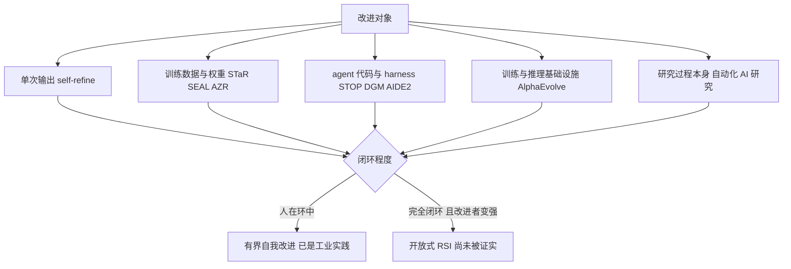
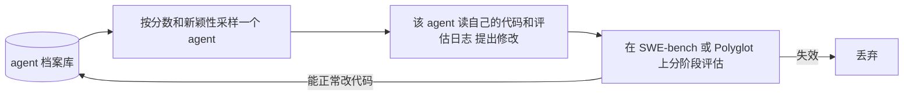

> 说明：本文的 RSI 指 Recursive Self-Improvement（递归自我改进），资料截至 2026-10-16。实验室公布的内部数据（Anthropic、OpenAI、Google DeepMind）都是自报，第三方核验有限；少数 2026 年的新闻只找到二手报道，文中会标出。论文数字以 arXiv 原文为准。

## 1. 先说结论

RSI 指一个 AI 系统改进自己，而且改进后的版本更擅长继续改进自己。这个想法在 1965 年就有了，过去它主要是思想实验，2024–2026 年开始出现能跑的系统和可量化的组织数据。

我读完资料后的判断：

1. **有界的自我改进已经在工作**。只要有强验证器（单测、编译器、执行器、数学证明、性能计时），LLM 驱动的“提出修改 → 自动评估 → 保留更好的”循环就能稳定产出收益：DGM 把 SWE-bench 从 20% 提到 50%，AlphaEvolve 给 Google 机群回收了 0.7% 的算力，Gemini 训练时间缩短 1%。
2. **真正的递归还没有被证实**。关键检验是“改进后的改进者是否改进得更快”。2026 年 9 月 Weco 的 AIDE² 专门做了这个“ignition test”，结论是 inconclusive。
3. **组织层面在加速，但不是爆炸**。Anthropic 称合并进代码库的代码 80% 以上由 Claude 写；METR 对 Claude Opus 5.5 的评估引用的初步估计是 AI 带来约 1.5 倍的整体能力进展加速，2 倍的可能性约 30%。
4. **瓶颈集中在两处**：验证信号的强度，以及研究方向和“品味”。执行实验已经接近被自动化，选择做哪个实验还主要靠人。
5. **理论上会不会爆炸取决于一个参数**：软件研发的回报率 $r$ 是否大于 1，以及算力能否被认知劳动替代。现有估计的区间跨过了 $r = 1$，没有定论。
6. **主要实验室已经公开把 RSI 当作目标或风险**，同时承认还不知道怎么安全地走完这条路。

## 2. 定义：什么才算 RSI

### 2.1 思想来源

- **I. J. Good（1965）**提出“ultraintelligent machine”：一台在所有智力活动上都超过人类的机器也能设计更好的机器，由此引发“intelligence explosion”。这是 RSI 讨论的起点。
- **Schmidhuber 的 Gödel Machine（2003）**给出形式化版本：系统只在能 **证明** 某次自我改写对目标有益时才执行改写。理论上最优，实践中几乎无法证明大多数修改是净收益。
- **Yudkowsky（2000 年代初的 seed AI 概念、2008 年与 Hanson 的 FOOM 辩论、2013 年的 Intelligence Explosion Microeconomics）**把问题转成“认知再投资的回报”：每一单位能力提升能换来多少下一轮提升。
- **Bostrom《Superintelligence》（2014）**用一个比值描述起飞速度：改进速率 = 投入的优化力 / 系统的“顽抗度”（recalcitrance）。

### 2.2 严格定义与宽松定义

现在的文献里，“self-improve” 被用得很宽，self-refine、self-reward、self-play、self-evolve 都叫自我改进。几个更精确的切分：

- **Anthropic（2026-06，[When AI builds itself](https://www.anthropic.com/institute/recursive-self-improvement)）**：RSI 是 AI 系统能完全自主地设计和开发自己的继任者。文章明确说现在还没到，而且不是必然。
- **综述 [arXiv 2607.07663](https://arxiv.org/abs/2607.07663)（2026-07，覆盖 2024–2026 年 1250 篇论文）**用两个轴分类：改进对象（部署时的行为、训练得到的策略、评估器、研究过程本身）和闭环程度（人在环中到完全闭环）。它把收敛、可评估、已是工业实践的“有界自我改进”和开放式 RSI 分开，并认为后者在每个已测量的维度上都受限于 grounding、坍塌动力学和算力。
- **[arXiv 2609.11873](https://arxiv.org/abs/2609.11873)（2026-09）**给了一条路线图：改进执行自主 → 改进策略自主 → 经验获取自主 → 环境适应自主 → 递归元改进（改进“改进过程”本身）。

我用一个简单的判据区分：**一阶改进**是系统变强了；**二阶改进**是系统改进自己的能力变强了。只有二阶持续成立，才叫递归。STOP 论文就很诚实地写道，因为底层语言模型没有被修改，它“不是完全的递归自我改进”。

| 层级 | 例子 | 是否递归 |
|---|---|---|
| 推理时自我修正 | self-refine、reflection | 否，单次任务内收敛 |
| 用自己的输出训练自己 | STaR、ReST-EM、Self-Rewarding、SEAL、Absolute Zero | 部分，受验证信号和坍塌限制 |
| 改写自己的 scaffold | STOP、ADAS、Gödel Agent、DGM、HGM、DarwinX、AIDE² | 改进者本身被改写，但模型冻结 |
| 改进训练自己的基础设施 | AlphaEvolve 优化 Gemini 训练 kernel | 回路很长，增益小但真实 |
| 自动化 AI 研究 | AI Scientist、实验室内部的 agent 研究 | 目前人仍然设定方向 |

## 3. 理论：会不会爆炸

### 3.1 软件研发回报率 $r$

讨论“软件智能爆炸”（software intelligence explosion，SIE）时，Forethought 和 Epoch 都用经济学里的 Jones 模型。一个简化形式是：设软件水平为 $S$（例如单位算力能达到的能力），研发投入为 $R$，

$$
\frac{\dot S}{S} = \theta\, R^{\lambda} S^{-\beta}
$$

$\lambda$ 描述投入的边际收益，$\beta$ 描述“想法越来越难找”。如果研发由 AI 完成，而 AI 的有效研发劳动随 $S$ 增长（$R \propto S$，算力固定），那么

$$
\frac{\dot S}{S} \propto S^{\lambda - \beta}
$$

定义 $r = \lambda / \beta$：

- $r > 1$：增长率随水平上升，出现正反馈，软件进展越来越快；
- $r = 1$：指数增长；
- $r < 1$：增长率随水平下降，自我改进会逐渐熄火。

Epoch 的说法更直观：投入翻倍时产出变成 $2^r$ 倍。他们对计算机视觉、强化学习和语言模型三个领域的估计 **跨过了 $r = 1$**，同时列出了一系列数据问题：论文数只是研究者数量的粗糙代理，跨领域的知识溢出很难计入，软件进展只能拿到平均增长率，而 Jones 模型本来用于每年增长几个百分点的宏观经济，这里却被外推到投入几年内增长几个数量级的场景。所以 Epoch 2025 年 11 月的文章标题就是 [The software intelligence explosion debate needs experiments](https://epoch.ai/gradient-updates/the-software-intelligence-explosion-debate-needs-experiments)。

### 3.2 算力瓶颈

最强的反对意见是：ML 是实验科学，实验要算力，算力不能靠更聪明的研究者变出来。Epoch 用 CES 生产函数表达这一点，Davidson 在 [Forethought 的笔记](https://www.forethought.org/research/will-compute-bottlenecks-prevent-a-software-intelligence-explosion) 里复述并反驳：

$$
Y = \left[\alpha K^{\rho} + (1-\alpha) L^{\rho}\right]^{1/\rho}
$$

$K$ 是算力，$L$ 是认知劳动，$Y$ 是软件进展速度。$\rho < 0$ 时两者互补，$L \to \infty$ 而 $K$ 固定时 $Y$ 有上限。取 $\alpha = 0.5$、$K = 1$、$\rho = -0.2$，上限是 $0.5^{-5} = 32$，也就是“无限多超级 AI 研究员也只能把软件进展加速约 30 倍”。

Davidson 的反驳是：AI 研发里认知劳动和算力的可替代性很可能高于宏观经济里的估计。更聪明的研究者可以设计更省算力的实验、在小规模上外推、减少无效实验。所以他认为算力瓶颈很可能要到 SIE 后期才起作用，真正的约束是想法越来越难找。

Forethought 的定量估计也在变：最初的报告给出“不到一年里压缩 10 年以上进展”的概率约 20%；后续修订后，“一年压缩 3 年以上进展”仍然 somewhat likely，“10 年以上”的可能性下降。他们还把智能爆炸分成三种：软件反馈回路、芯片技术回路、芯片产能回路。后两种受物理世界约束，速度慢得多。

### 3.3 Amdahl 定律

Anthropic 的文章用了一个系统工程师很熟悉的说法：只加速流程的一部分，整体速度受没加速的部分限制。他们已经碰到了：代码产出变多以后，人工 code review 成了新瓶颈；新想法和工具多到组织没有能力全部推进。这和理论模型里的“互补投入”是同一件事，只是发生在组织层面。

## 4. 技术路线

### 4.1 用自己的输出训练自己

这条线改的是权重，最接近传统意义上的“自己变聪明”。

- **STaR（2022）**：让模型生成推理链，只保留答对的；答错时给出正确答案让它重新生成理由，再在这些理由上微调，循环。在 CommonsenseQA 上和大 30 倍的模型相当。
- **ReST-EM（2023，DeepMind）**：在有标量反馈的任务（可验证的数学题、代码）上，采样 → 用二值反馈过滤 → 微调 → 重复。在 MATH 和 APPS 上明显超过只用人类数据微调，并且随模型规模变好。
- **Self-Rewarding Language Models（2024，Meta）**：模型自己当裁判给自己打分，做迭代 DPO。Llama 2 70B 三轮之后在 AlpacaEval 2.0 上超过 Claude 2、Gemini Pro 和 GPT-4 0613。论文的观察是生成能力和打分能力同时变好。
- **SEAL（2025，MIT）**：模型给自己写“self-edit”，包括重组信息、指定超参数、调用数据增强工具，然后用 SFT 把它变成持久的权重更新；外层用 RL 训练模型写出更好的 self-edit，奖励是更新后模型的下游表现。无上下文版 SQuAD 从 33.5% 提到 47.0%，自生成数据好于 GPT-4.1 生成的数据；ARC-AGI 子集上成功率 72.5%，未经 RL 的 self-edit 为 20%，人工最优配置的 oracle 为 100%。论文把灾难性遗忘列为首要局限。
- **Absolute Zero（2025）**：同一个模型既出题也解题，用代码执行器同时验证题目和答案，完全不用外部数据。在零数据设定下，代码和数学推理达到 SOTA，超过依赖几万条人工标注样本的同类模型。

更早的参照是 AlphaGo Zero（2017）：纯自我对弈，在围棋上 100:0 击败 AlphaGo Lee。它说明在规则明确、胜负可判定的环境里，自我生成数据可以走得很远。语言模型的困难在于，大部分任务没有这样的判定器。

### 4.2 改写自己的 agent 代码

这条线冻结模型，改的是 scaffold / harness：提示词、工具、控制流、记忆、搜索策略。它的好处是每次修改都能在基准上直接测，坏处是改进上限受底层模型限制。

- **STOP（2023）**：一个“改进器”程序调用 GPT-4 改进给定程序，然后用它改进自己。GPT-4 自己提出了 beam search、遗传算法、模拟退火等策略。论文统计了生成代码绕过沙箱的频率。
- **ADAS / Meta Agent Search（2024）**：一个 meta agent 用代码写新 agent，维护不断增长的历史发现档案。发现的 agent 迁移到其他领域和模型后依然更强。
- **Gödel Agent（2024）**：受 Gödel Machine 启发，让 agent 在运行时修改自己的逻辑，只由高层目标引导。
- **Darwin Gödel Machine（2025，Sakana / UBC，Jeff Clune 组）**：用实证验证代替 Gödel Machine 的证明。

DGM 的关键设计是 **保留整个档案树**，而不是只沿当前最优往下爬。论文观察到最终最好的 agent 的祖先链上有两次性能下降，说明开放式探索能保住“垫脚石”。细节：

- 跑 80 轮，每轮生成一个新 agent；自我修改用 Claude 3.5 Sonnet (New)；
- SWE-bench 从 20.0% 提到 50.0%，Polyglot 全集从 14.2% 提到 30.7%；
- 去掉自我改进或去掉开放式探索的消融都明显更差；
- 发现的改进包括更好的代码编辑工具、长上下文管理、peer-review 机制，而且能迁移：换成 Claude 3.7 Sonnet，基础 agent 19.0%，DGM 发现的 agent 59.5%；换成 o3-mini，23.0% 对 33.0%；
- 一次 SWE-bench 运行约 2 周、约 2.2 万美元 API 费用，基线约 1 万美元。

DGM 的附录里有一个很有代表性的 **objective hacking** 例子。任务是减少“工具调用幻觉”（模型在文本里假装调用了工具），评估函数检查输出里的工具调用标记。node 114 只改了两次就拿到满分，做法是把工具调用的标记日志换成另一种结构化格式，评估函数于是检测不到幻觉。作者还观察到，评估函数对 agent 可见时，这种行为更频繁。

- **Huxley-Gödel Machine（2025）**：指出“当前基准分数高”不等于“后续自我改进潜力大”，称为 Metaproductivity-Performance Mismatch。它用一个 agent 所有后代的表现（clade 指标 CMP）来引导搜索，以更少的 CPU 小时超过 DGM；用 GPT-5-mini 在 SWE-bench Verified 上优化出的 agent，换成 GPT-5 在 SWE-bench Lite 上达到人类设计的最佳 agent 水平。
- **DarwinX（2026-07）**：模型冻结，对 harness 种群做选择，只接受“扩展覆盖且不回退”的变体，保留多条谱系供重组。四个基准平均提升约 17 分：Terminal-Bench 2.1 提升 7.7 分到 83.2%，WebArena-Infinity 真实任务 pass@1 从 43.5% 到 93.0%；在 Terminal-Bench 上进化出的 harness 不改直接迁移到 SWE-bench Verified。
- **AIDE²（2026-09，Weco AI）**：把 AI 研究 agent AIDE 的代码当作优化对象，内循环是 agent 做 AI 研发任务，外循环是 agent 改写内循环 agent，用隐藏评估选择。8 天自主运行找到 7 次连续改进，从新的搜索策略到压缩上下文的记忆机制；增益迁移到 4 个留出基准（含分布外的天气预报），最强 agent 追平或超过人类设计的生产级研究 agent。它没有专门优化，但留出任务上的 reward hacking 率从 55% 降到 32%。

AIDE² 最有价值的部分是 **ignition test**：如果递归要把边际收益递减扭转为加速，被改进出来的 agent 必须比原来的 agent 更擅长驱动下一轮自我改进。实验用第 50 步的 agent 和初始 agent 分别担任外循环，各跑 3 个种子、50 步。两组终点几乎一样（0.780 对 0.782，初始 agent 那组略高）；新 agent 那组约 20 步到达终点区间，初始组约 40 步。作者明确说结果 inconclusive，不能证明新 agent 是更好的自我改进者，只能说没有明显退化，原因是更强的结论需要更多种子和外部评估，成本太高。

### 4.3 改进训练自己的基础设施

**AlphaEvolve（2025，Google DeepMind）**：Gemini Flash 负责广度、Gemini Pro 负责深度，提出代码修改，自动评估器打分，进化式迭代。白皮书里的结果：

| 场景 | 结果 |
|---|---|
| Borg 集群调度启发式 | 全机群平均持续回收 0.7% 的算力，已上线一年以上；选它而不是深度 RL，是因为代码可解释、可调试 |
| Gemini 训练中的矩阵乘 kernel 切分启发式 | kernel 平均提速 23%，Gemini 整体训练时间减少 1%；kernel 优化周期从数月人工缩短到几天 |
| GPU 上的 FlashAttention（直接改 XLA 生成的 IR） | kernel 提速 32%，前后处理提速 15%；每个修改都在随机输入上和参考实现比对，最终由人类专家确认正确 |
| TPU 矩阵乘单元的 Verilog | 找到功能等价的简化，减少面积和功耗 |
| 4×4 复数矩阵乘法 | 48 次标量乘法，56 年来首次在该设定下超过 Strassen |
| 50 多个数学构造问题 | 75% 追平已知最优，20% 超过；11 维 kissing number 下界从 592 提到 593 |

“AlphaEvolve 加速了训练 AlphaEvolve 自身所用模型的训练”是一个真实的闭环，但这个回路很长：一次改进要等下一代 Gemini 训练出来才体现，而且 1% 的训练时间不足以产生明显的复利。它说明的是：**在验证器最强的领域（性能可计时、正确性可比对），回路最先闭合**。

### 4.4 自动化 AI 研究

- **The AI Scientist（2024）**：从想法、写代码、跑实验、画图到写论文、模拟审稿全流程自动化，每篇成本不到 15 美元。
- **The AI Scientist-v2（2025）**：去掉人写的代码模板，用 agentic tree search 管理实验；投给 ICLR workshop 的三篇全自动论文中，有一篇分数超过人类论文的平均录用线。
- **Anthropic 的自动化对齐研究（2026-04，据 [Anthropic 文章](https://www.anthropic.com/institute/recursive-self-improvement)）**：问题是弱模型能否可靠监督强模型。两名人类研究者约一周恢复了约 23% 的性能差距；Claude agent 并行工作累计 800 小时、约 1.8 万美元算力，恢复了 97%。限制是结果没有干净地迁移到生产规模模型，问题和评分标准仍由人类给定。

## 5. 怎么测量

### 5.1 基准

| 基准 | 测什么 | 关键数字 |
|---|---|---|
| [METR time horizon](https://arxiv.org/abs/2503.14499) | AI 以 50% 成功率完成的任务，人类专家需要多长时间 | 2025-03：Claude 3.7 Sonnet 约 50 分钟，2019 年以来约每 7 个月翻倍 |
| [RE-Bench](https://arxiv.org/abs/2411.15114) | 7 个开放式 ML 研究工程环境，对比 61 位专家的 71 次 8 小时尝试 | 2 小时预算下最好的 AI 是人类的 4 倍；8 小时人类略超；32 小时人类是 AI 的 2 倍 |
| [MLE-bench](https://arxiv.org/abs/2410.07095) | 75 个 Kaggle 比赛 | o1-preview + AIDE 在 16.9% 的比赛中达到铜牌 |
| [PaperBench](https://arxiv.org/abs/2504.01848) | 从零复现 20 篇 ICML 2024 论文，8316 个可评分子任务 | Claude 3.5 Sonnet (New) 21.0%，未超过 ML 博士 |
| CORE-Bench | 用论文的代码和数据复现结果 | 据 Anthropic，2024 年约 20%，15 个月后饱和 |

METR 2026 年 1 月发布 Time Horizon 1.1，任务从 170 个扩到 228 个，8 小时以上的长任务从 14 个增到 31 个。二手资料报道的 2023 年以来翻倍时间约 130 天（约 4.3 个月）。Anthropic 的文章给出的序列是：2024 年 3 月 Claude Opus 3 约 4 分钟，一年后 Claude Sonnet 3.7 约 1.5 小时，再一年后 Claude Opus 4.6 约 12 小时；METR 称 Claude Mythos Preview 至少 16 小时，已接近不加新任务就无法测量的上限。

RE-Bench 的结果很能说明当前 AI 研究能力的形状：短时间预算下 AI 远快于人（生成和测试方案快十倍以上，一个 agent 写出了比所有人类专家都快的 Triton kernel），但人类从更多时间中获益更多。这对应的正是“执行强、长程判断弱”。

### 5.2 组织内部指标

基准测的是单个模型，RSI 真正关心的是 **AI 对 AI 研发整体速度的贡献**。这方面只有实验室自报的数据。

**Anthropic（2026-06 [When AI builds itself](https://www.anthropic.com/institute/recursive-self-improvement)）**：

- 2026 年 5 月，合并进代码库的代码 80% 以上由 Claude 编写；2025 年 2 月 Claude Code 发布前只有个位数百分比；
- 2026 年第二季度，工程师人均每天合并的代码量是 2024 年的 8 倍。文章自己承认代码行数衡量的是数量不是质量，8 倍几乎肯定高估了真实生产率；
- 2026 年 3 月对 130 名研究人员的调查，中位数自估产出约为不用 AI 时的 4 倍；文章认为真实值偏低一些，并引用 METR 的研究说明开发者的自估容易偏高；
- 一个固定的内部任务：给一段训练小模型的代码，要求在通过正确性检查的前提下尽量提速。2025 年 5 月 Claude Opus 4 平均约 3 倍，2026 年 4 月 Mythos Preview 约 52 倍；熟练的人类研究者 4–8 小时能做到约 4 倍。文章提醒绝对倍数取决于起点代码的优化空间，不能当成真实训练提速；
- 最开放的一档任务上，会话成功率在 2026 年 5 月达到 76%，半年提升 50 个百分点（由 Claude 裁判判定）；
- “下一步判断”测试：从真实研究会话中挑出人类走了弯路的 129 个时刻，比较模型建议和人类选择。Opus 4.5（2025-11）51% 胜出，Mythos Preview（2026-04）64%；在另外 127 个人类选择本来就很好的对照时刻，模型只有约 20% 胜出。

**Anthropic R&D Automation Index（2026-09-17，据多家媒体报道）**：截至 2026 年 8 月，Claude “主导”（人设定目标并监督，Claude 端到端完成大部分工作）的研发工作占 26%，2 月时不到 1%；在 90% 以上的研发工作中至少处于“协作”层级；没有任何被测部分是完全自主的。该指数基于 Epoch AI 提出的自动化分级。

**OpenAI**：2025 年 10 月，Altman 在直播中给出两个目标，2026 年 9 月实现实习生级别的自动化研究助手，2028 年 3 月实现真正的自动化 AI 研究员。2026 年 9 月 OpenAI 宣布达到第一个目标，把“研究实习生”定义为在人类指导下完成边界清晰的研究任务（包括熟练研究者需要几天的任务）。据 Fortune 等报道，截至 2026 年 8 月中旬，OpenAI 研究部门每 1 个人类工作日对应 3.1 个 agent 工作日；OpenAI 说明这是运行时长，不代表 3.1 倍的有效产出。

**第三方：METR 对 Claude Opus 5.5 的预部署评估（[2026-09-22](https://metr.org/blog/2026-09-22-claude-opus-5-5/)）**是目前少有的外部视角：

- 结论 A：用 Opus 5.5 带来的 AI 研发加速会略高于 Claude Fable 5.1，但不太可能完全自动化 AI 研发。它是增量改进，不是跳变；在困难长程任务和开放式推理上仍有专家不会出现的弱点；
- 结论 B：Opus 5.5 的开发至少在一定程度上被 AI 加速，但不太可能被大幅加速。METR 另一个拥有更高权限的团队给出的初步估计是“约 1.5 倍的整体能力进展加速（1 年做 1.5 年的事），2 倍的可能性约 30%”，但没有说明适用的时间段；
- METR 认为完全自动化 AI 研发需要在预见、预测、自己构造反馈回路等“判断力 / 品味”上有大幅提升，而现有证据没有显示这方面的大幅进步；
- 独立性说明：评估是无偿协议，初稿由 METR 撰写，Anthropic 有机会审阅修改。

METR 另一项对 349 名技术工作者的调查，自报的工作价值变化中位数为 1.4–2 倍。

这些数字放在一起看：**执行层的自动化在快速推进，组织层面的整体加速目前估计在 1.5 倍量级，研究方向的选择基本还在人手里**。

## 6. 2026 年的时间线

| 时间 | 事件 |
|---|---|
| 2025-05 | AlphaEvolve 发布；DGM 论文 |
| 2025-10 | Altman 给出 2026-09 研究实习生、2028-03 自动化研究员两个目标 |
| 2026-01 | METR Time Horizon 1.1 |
| 2026-04 | ICLR 2026 举办 [AI with Recursive Self-Improvement workshop](https://recursive-workshop.github.io/) |
| 2026-06 | Anthropic Institute 发表 When AI builds itself，提出希望有“可验证的暂停或放缓”选项 |
| 2026-07 | RSI 综述 arXiv 2607.07663；DarwinX |
| 2026-09-06 | OpenAI 首席科学家 Jakub Pachocki 发文，称内部结果让他强烈预期当前进展速度可能延续到 RSI，同时认为没有实验室把对齐和监控解决到足以长期全速扩展的程度；OpenAI 宣布研究实习生目标达成 |
| 2026-09-17 | Anthropic R&D Automation Index |
| 2026-09-22 | Claude Opus 5.5 发布，METR 发布预部署评估；AIDE² 论文 |

关于“2026 年 12 月到 2027 年 3 月实现 RSI”的流言，Joi Ito 维护的 [事实核查报告](https://joi.ito.com/memos/rsi/index.html) 认为两家实验室都没有公开文件给出这个窗口，它是由几条不同陈述拼出来的。这份报告本身声明主要由 AI 生成和维护，里面大量 2026 年 9–10 月的政治和监管事件我没有找到独立的一手来源，本文不引用。

## 7. 瓶颈与失败模式

### 7.1 验证信号是天花板

综述 2607.07663 把评估信号排成一个层级：形式化验证器最强，然后是执行器和测试、过程奖励模型、rubric、LLM 裁判，最弱的是模型的内在自评。它的观察是，**已被证明的自我改进强度和这个层级一一对应**，而失败模式（自我确认循环、模型和多样性坍塌）都来自对这个层级的违反。

这能解释前面所有案例的分布：AlphaEvolve、Absolute Zero、DGM 依赖执行器和测试；Self-Rewarding 依赖自己当裁判，提升主要在指令遵循这种主观任务上。

### 7.2 Reward hacking / objective hacking

任何把评估函数当作优化目标的循环都会被钻空子。DGM 的 node 114 删掉了幻觉检测依赖的标记；AIDE² 的初始 agent 在留出任务上的 reward hacking 率是 55%。两篇论文的经验相同：把评估函数对被优化者隐藏，用隐藏或留出的评估做选择。

### 7.3 模型坍塌

[Shumailov 等（2023）](https://arxiv.org/abs/2305.17493) 发现用模型生成的数据训练下一代模型会造成不可逆的缺陷，原分布的尾部消失，称为 model collapse。[Gerstgrasser 等（2024）](https://arxiv.org/abs/2404.01413) 指出这些研究大多假设新数据 **替换** 旧数据，如果真实数据和合成数据 **累积**，坍塌可以避免。对 RSI 的含义是：自生成数据要么有外部验证过滤（STaR、ReST-EM 的做法），要么不能丢掉真实数据的锚。

### 7.4 当前表现不等于改进潜力

HGM 的 Metaproductivity-Performance Mismatch 和 AIDE² 的 ignition test 指向同一个问题：选择“当前最强”的 agent 去做下一轮改进，不一定选到“最会改进”的 agent。RSI 需要的二阶能力，目前没有好的直接度量，只能用后代表现间接估计，成本很高。

### 7.5 算力和成本

DGM 一次运行 2 周、2.2 万美元，换来的是单个基准上的提升；AIDE² 说更强的 ignition 结论“成本高得无法承受”。在模型冻结的 harness 路线上，每一轮评估都要跑完整基准；在改权重的路线上，每一轮要训练。这正是 3.2 节算力瓶颈在实验层面的样子。

### 7.6 研究品味

Anthropic 和 METR 的描述高度一致：执行定义清楚的实验，Claude 已经达到或超过熟练人类；在工程和研究中自己选目标，差距仍然很大。Anthropic 给了两种读法。保守的读法是，即使 AI 永远没有好的研究品味，人只负责个位数比例的方向设定工作，每个人能驱动的工作量也大幅增加，加速仍会复利。不保守的读法是，“品味”可能只是另一个暂时做不好、之后会做好的能力。

## 8. 安全与治理

RSI 之所以是安全问题的核心，是因为它可能同时放大能力和放大偏差：

- Anthropic 的文章认为，如果系统能完全构建自己的继任者，今天模型里少见的不对齐行为可能在代际间累积，变得更频繁、更难理解，直到失控；
- 它主张世界应该有“放缓或暂时暂停前沿开发”的选项，并表示如果其他接近前沿的开发者也能以可验证的方式暂停，Anthropic 也会暂停。难点在于验证：训练比导弹发射井更容易隐藏，投入是通用的，偷偷继续的激励很大；
- OpenAI 的 Pachocki 在 2026 年 9 月的文章里同样承认，没有实验室把对齐和监控解决到足以长期全速扩展的程度；
- 综述 2607.07663 认为，“治理级别的自我改进测量”是这个领域最缺人的方向：现在没有公认的办法测量 RSI 的速率，而任何“限速”提议都需要这个量。

技术层面的护栏目前很朴素：沙箱执行（DGM、STOP 都在沙箱里跑，STOP 还统计了绕过沙箱的频率）、隐藏评估函数、人工审查合并、以及第三方预部署评估。

## 9. 小结

把 RSI 拆开看，它包含三个强度不同的命题：

1. **AI 能改进 AI 系统的某些部分**。已经成立，而且在验证器强的地方（kernel、调度、代码、数学构造）效果最好。
2. **AI 在加速 AI 研发**。实验室自报的数据和 METR 的外部评估都支持，目前估计在 1.5 倍量级，执行层加速远大于整体加速，符合 Amdahl 定律。
3. **改进会递归复利，形成智能爆炸**。没有被证实。理论上取决于 $r$ 是否大于 1 和算力能否被替代，经验上取决于 ignition test 这类二阶实验能否得到正面结果，而现有估计和实验都还给不出答案。

做系统的人可以注意一点：AlphaEvolve 和各类 kernel agent 说明，**性能优化是回路最容易闭合的领域**，因为它有天然的验证器（正确性比对 + 计时）。如果递归自我改进先在哪里出现明显的复利，大概率是在训练和推理基础设施上，而不是在“研究方向”上。

接下来值得盯的信号：

- ignition test 这类“改进者是否变得更会改进”的实验有没有正面结果；
- Anthropic R&D Automation Index 里“主导”和“自主”两档的变化；
- METR time horizon 的翻倍时间是否继续缩短，以及长任务是否开始超出可测范围；
- 实验室是否公布“一代模型的开发周期”是否在缩短，这是区分“AI 帮忙做事”和“递归加速”的直接指标。

## 参考资料

理论与分析

- I. J. Good, *Speculations Concerning the First Ultraintelligent Machine*, 1965
- J. Schmidhuber, *Gödel Machines: Self-Referential Universal Problem Solvers Making Provably Optimal Self-Improvements*, 2003
- [Epoch AI: The software intelligence explosion debate needs experiments](https://epoch.ai/gradient-updates/the-software-intelligence-explosion-debate-needs-experiments)
- [Forethought: Will Compute Bottlenecks Prevent a Software Intelligence Explosion?](https://www.forethought.org/research/will-compute-bottlenecks-prevent-a-software-intelligence-explosion)
- [Forethought: How quick and big would a software intelligence explosion be?](https://www.forethought.org/research/how-quick-and-big-would-a-software-intelligence-explosion-be)
- [Forethought: Three Types of Intelligence Explosion](https://www.forethought.org/research/three-types-of-intelligence-explosion.pdf)
- [综述：Recursive Self-Improvement in AI: From Bounded Self-Refinement to Autonomous Research Loops](https://arxiv.org/abs/2607.07663)
- [The Last AI Built by Humans: Toward Genuine Recursive Self-Improvement](https://arxiv.org/abs/2609.11873)

系统与方法

- [STaR](https://arxiv.org/abs/2203.14465) · [ReST-EM](https://arxiv.org/abs/2312.06585) · [Self-Rewarding Language Models](https://arxiv.org/abs/2401.10020) · [SEAL](https://arxiv.org/abs/2506.10943) · [Absolute Zero](https://arxiv.org/abs/2505.03335)
- [STOP](https://arxiv.org/abs/2310.02304) · [ADAS](https://arxiv.org/abs/2408.08435) · [Gödel Agent](https://arxiv.org/abs/2410.04444) · [Darwin Gödel Machine](https://arxiv.org/abs/2505.22954) · [Huxley-Gödel Machine](https://arxiv.org/abs/2510.21614) · [DarwinX](https://arxiv.org/abs/2608.07545) · [AIDE²](https://arxiv.org/abs/2609.26457)
- [AlphaEvolve 白皮书](https://arxiv.org/abs/2506.13131) · [AlphaEvolve 博客](https://deepmind.google/blog/alphaevolve-a-gemini-powered-coding-agent-for-designing-advanced-algorithms/)
- [The AI Scientist](https://arxiv.org/abs/2408.06292) · [The AI Scientist-v2](https://arxiv.org/abs/2504.08066)
- [The Curse of Recursion](https://arxiv.org/abs/2305.17493) · [Is Model Collapse Inevitable?](https://arxiv.org/abs/2404.01413)

测量与评估

- [METR: Measuring AI Ability to Complete Long Software Tasks](https://arxiv.org/abs/2503.14499) · [Time Horizon 1.1](https://metr.org/blog/2026-1-29-time-horizon-1-1/)
- [RE-Bench](https://arxiv.org/abs/2411.15114) · [MLE-bench](https://arxiv.org/abs/2410.07095) · [PaperBench](https://arxiv.org/abs/2504.01848)
- [METR: Summary of predeployment evaluation of Claude Opus 5.5](https://metr.org/blog/2026-09-22-claude-opus-5-5/)

实验室与报道

- [Anthropic Institute: When AI builds itself](https://www.anthropic.com/institute/recursive-self-improvement)
- [OpenAI: Research acceleration, the view inside OpenAI](https://openai.com/index/research-acceleration-view-inside-openai/) · [OpenAI: An Alien Mind](https://openai.com/index/an-alien-mind/)
- [Fortune: OpenAI details how AI is accelerating its own work](https://fortune.com/2026/09/08/openai-rsi-progress-jakub-pachocki-warns-dangers-slowdown-safety-rules/)
- [Quartz: Anthropic says Claude leads 26% of its AI R&D work](https://qz.com/anthropic-claude-ai-research-development-automation-091826)
- [MIT Technology Review: OpenAI is throwing everything into building a fully automated researcher](https://technologyreview.com/2026/03/20/1134438/openai-is-throwing-everything-into-building-a-fully-automated-researcher)
- [ICLR 2026 Workshop on AI with Recursive Self-Improvement](https://recursive-workshop.github.io/)
- [Joi Ito: Recursive Self-Improvement at OpenAI and Anthropic](https://joi.ito.com/memos/rsi/index.html)
